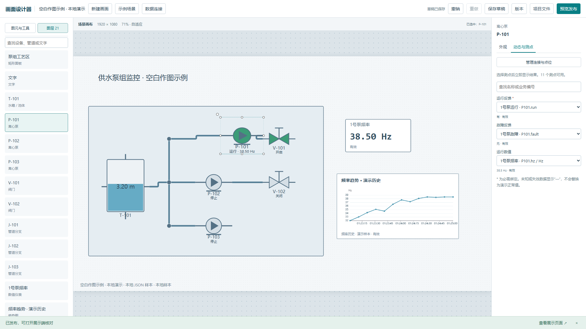
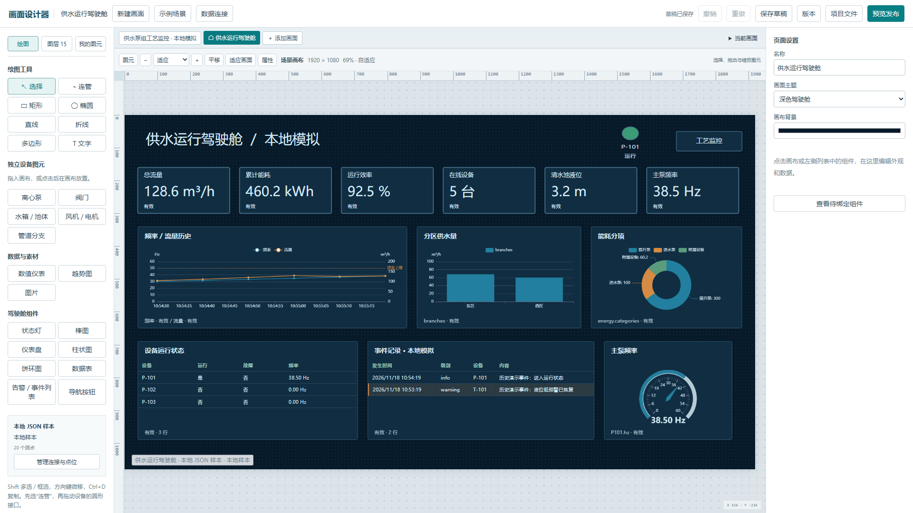

# 工业可视化配置工作台

工作台入口提供项目管理和案例库。项目管理用于新建、导入、复制草稿与重命名工程。工程包含自己的画布、测点、草稿和发布版本。案例库扫描仓库现有的 01–30 号及定制工艺页面，可按行业或名称、编号查询，并打开原版或对应可编辑工程。

在仓库根目录运行 `node apps/scada-designer/server.mjs`，打开 [本地项目管理](http://127.0.0.1:8099/projects)。已有单工程实例继续支持 `/editor`、`/view` 和原有数据存储。独立工程通过 `/editor?project=工程ID` 及 `/view?project=工程ID` 打开。通过 `STUDIO_DATA_DIR` 启动的旧实例保留原首页行为，设置 `STUDIO_ENTRY=projects` 可将其首页切换为项目管理。

有已交付的本机验收工程时，可在目标服务开启前运行 `node scripts/collect-studio-projects.mjs <工程数据目录>` 将可用档案归集。归档重跑保留同 ID 已有工程，缺失的本机档案仍可从案例库浏览原版。也可直接在项目管理中导入导出的工程 JSON。

画面设计器支持空白作图、端口、数据槽位、显示规则、图元库、多画面、图表和发布。详见 [设计器整体验收](../../docs/acceptance/screen-designer-stages.md) 和 [项目入口验收](../../docs/acceptance/studio-project-platform.md)。

## 从空白设计一张工艺监控画面

1. 点击顶部“新建画面”。在当前项目增加 1920×1080 空画面；现有连接、点表和我的图元共用，可通过上方画面标签往返。首次启动则没有任何设备或测点。
2. 左侧“图元与工具”选择矩形、椭圆、直线、折线、多边形或文字，在画布点击/拖画；泵、阀、池体、风机、管道分支可拖入，或点击图元后点击画布放置。数值仪表、趋势、图片也可任意摆放。图片先放置，再在右侧载入本地 PNG/JPEG/WebP 或自包含静态 SVG。
3. 选择“连管”，从设备的圆形接口拖向另一台设备接口；也可拖向空白，或直接在空白拖出两端开放的管道。管道绑定设备端口；移动、旋转和缩放设备后保持连接。用“管道分支”连接支路。切回“选择”，选中管道可拖动管段或在路径上增加转折点。流动动画需另外绑定有效的布尔测点。
4. 点击对象或左侧“图层”，在右侧改位号、位置、尺寸、颜色和显示参数。画布有吸附、八方向缩放柄和旋转柄；Shift 多选/框选，可对齐、分布、成组。方向键微移，Ctrl+D 复制，Delete 删除，Ctrl+Z 撤销，Ctrl+Shift+Z 重做。普通复制会清空新实例的绑定。需要在同一项目展示同一测点时，可用“带测点复制”。组内管道端点都会改为新设备。
5. 选中设备后切到右侧“动态与测点”。泵绑定运行/故障，阀绑定开到位/故障，池体绑定液位；按需绑定设备数值。点击“管理连接与点位”，连接和选点后自动回到原设备。槽位按数据类型筛选。点“选择测点…”可搜索业务编号，在确认前预览当前值和质量。液位范围填写站点工程量程，单位可跟随测点或覆盖显示单位；修改显示单位不会换算原始值。
6. 放入数值仪表和趋势并绑定。趋势可接 `time/value` 行数据集，或绑定数值点，从接入时开始采样；不会补造历史。缩放时图表同步调整。空白状态下点击画布可设置画面名称和背景。
7. 保存草稿，再点“预览发布”。缺少必需绑定时显示问题列表并阻止发布；点击“去绑定”回到对应对象。当前通信无效会明确显示质量，不替换正常演示值。发布后打开独立展示端，点击设备查看只读详情。

新画布、预览、展示与离线导出使用同一文档和图元渲染器。发布端禁止绘图，当前没有设备写入操作。“项目文件”可导入/导出配置或导出单 HTML 离线演示；导入后返回画布。离线文件明确标注快照，不能作为实时现场读数。



## 预览演练工况

在数据连接中将本地 JSON 标记为演示样本，打开「预览发布」，展开「演练工况」。选择开关量、数值或文字测点，设置工程值或质量，再点「应用到预览」。例如将泵运行反馈设为释放、将频率输入 0，再将故障反馈设为成立，即可核对停机和故障显示。也可单独演练无效、过期和离线。

所有更改只作用于当前预览。可恢复单个测点或全部恢复，返回编辑也会恢复。草稿、发布和离线 HTML 继续使用原样本。现场连接和未标记的本地样本不提供演练入口。

## 定义连接点、测点接口与我的图元

泵、风机、阀门和止回阀可在“外观预设”选“本地图片外观”，再上传 PNG、JPEG、WebP 或静态 SVG。透明图稿适合贴合背景。图片会嵌入项目，端口、绑定和状态读数随设备独立保存。泵和风机的“监控铭牌”把位号放进设备图标，显示运行数值及“显示文字”槽位读取的模式。在线仪表可用“监控铭牌”，集泥井可用“监控液位”将短管对齐实际端口。

选中任意基础形状、设备或图表，打开右侧“元素定义”：

- **连接点**可增删、改名，选择边沿或输入 X/Y 百分比，设双向/流入/流出。编号保持稳定；已接管道的端口不能直接删除，应先重接管端。缩放/旋转后端点随设备移动。
- **数据槽位**定义“该元素需要什么数据”，可设名称、类型、用途与必需绑定。用途包括运行、故障、开到位、数值、文字、流动与附加数据。到“动态与测点”再选站点测点，槽位编号和实际点位 ID 分开。
- **显示规则**在“动态与测点”配置：选择槽位与比较/区间条件，再选填充、文字、可见性、旋转或流动结果。靠前的匹配规则优先；无效数据和设备故障优先于正常规则。工程量倍率/偏移在点表配置。
- 多选或成组后切左侧“我的图元”，命名保存，下一张空画面可直接放入。保存定义和导出的 `.symbol.json` 保留端口、槽位、规则及内部管道，清空具体站点绑定。新实例独立编号并重新选点；Alt 点击可选中组内子件。

画布工具条可缩放、平移、适应画面及收起两侧面板。Ctrl+滚轮以指针为中心缩放，中键或空格拖动平移；视口变化不改变对象坐标，也不进入撤销记录。

## 从空白制作驾驶舱

点击空白处，在页面设置选“灰色工艺 / 浅色监控 / 深色驾驶舱”。主题提供配色、边框与间距，保留手动设定的颜色；新对象继承当前主题。

左侧放数值仪表、状态灯、棒图、仪表盘、趋势、柱状图、饼环图、数据表、事件表和导航按钮。每个组件都能单独摆放和绑定：

- 指标可设标题、符号、单位、小数位；阈值变化使用显示规则。显示单位不进行量纲换算。
- 趋势/柱图在外观中配置序列、时间或分类字段、左右轴、单位/范围、图例和参考线。添加序列会添加对应槽位，切到动态页绑定。名称留空时跟随测点；换绑保留手动轴范围。
- 行数据可用 `[{"time":1794960000000,"frequency":38.5,"flow":128.6}]`；分别配置 `frequency` 和 `flow` 数值字段。分类柱图指定分类字段，饼环图指定分类和数值字段。数值趋势从接入时采样，失效形成断点。
- 数据表/事件表先绑定行数据，再点“从样本生成列”，改字段、列名、格式、单位、排序和最多显示行数。时间字段支持毫秒或可解析时间文本，布尔显示“是/否”，缺失显示“—”。事件表只展示上游事件，可选级别字段。
- “交互”提供只读详情、趋势、画面导航与 HTTP(S) 链接；编辑点击仅选择对象。页面标签可命名、设首页；发布检查覆盖全部画面，版本回退切换整个已发布项目。

[导入 A/B 示例](examples/water-process-and-cockpit.json)：在“项目文件 → 导入配置”选择该文件，再保存/预览/发布。A/B 几何直接来自空白作图验收，数据全部为本地模拟；导入会替换当前草稿，可先导出或撤销。新项目仍为零对象。



## 点表可先建、连接可后接

OPC UA 用设备树浏览并多选导入。Modbus 点表支持逐行新建、北向 JSON 导入和“批量地址”：填写编号前缀、起始编号、地址区、起始序号、数量、格式、步长和字序。界面序号从 1 开始，内部保存零基地址；例如输入 FC04 序号 101 保存为地址 100。32 位占两个寄存器，默认步长自动为 2。编号冲突、地址重叠或越界时整批拒绝，不插入一部分。

“试读点位”查看实际质量；“完成并返回画布”允许先保存合法点表。连接未建立或数据失效仍显示未知，不能以保存配置代替现场验证。

## 继续编辑旧项目或示例场景

1. 新画布顶部的“示例场景”（旧项目的“选择场景”）可打开原有 01、05、30 示例，再点击“使用该场景”。01、05 可明确选择“保留当前连接与点表”或“载入原版演示数据”；切换可撤销。三维联动演示明确载入自带本地样本。选择“空白画布”会切到新文档，不再插入旧场景片段。
2. 在“编辑画布”中从左侧添加组件，点击画布或对象树选中。V2 可展开到池体、管道、设备和文字，直接拖动对象，通过右侧位置、宽高调整；Alt 点击可选设备内的标签。可修改文字、颜色、图表序列名称/类型/坐标轴及管道转折点。Shift 多选可对齐、成组，支持复制、删除、锁定、撤销和重做。旧 V1 保留原来的标题拖拽与角落缩放方式。
3. 进入“数据绑定”，点击左侧“数据连接”，或选中组件后点击右侧“管理连接与点位”。选择 JSON、CSV、REST、WebSocket、OPC UA 或 Modbus TCP。连接窗口会显示当前场景和组件，取消修改不会改变原配置；完成后返回原组件。一个页面共用一条连接。
4. JSON / CSV / REST 方式可点击“读取样本”后填写映射。数组行例如：根路径 `points`、标识字段 `id`、匹配值 `LT01`、数值路径 `value`。相对于同一行填写源时间（ISO 8601 或 Unix 毫秒）及质量路径。缺少源时间配置时以接收时间判断新鲜度。CSV 数据表可绑定类型“行数据集”，路径填 `$`。数值支持倍率、偏移和小数位，枚举换算使用 JSON 对象，如 `{"ON":true,"OFF":false}`。工业协议选点方式见下文。
5. 应用连接后返回原选中对象。右侧“数据绑定”按命名插槽选点：05 泵分别绑定运行、故障、自动模式、频率和电流；01 设备卡分别绑定运行、故障和数值。选项按类型过滤，显示即时读数和质量；KPI 单位跟随测点。历史图表选择包含 `time`、`value` 的行数据集，也可绑定数值点，从接入时开始采样。完成一项可点“绑定下一个待处理组件”。异常值显示“—”，不补演示正常值。
6. 进入“预览发布”，右侧统一检查场景、数据来源、待绑定组件和当前数据质量。未完成绑定时不能发布，点击“去绑定”直接回到对应组件。样本来源会明确提示；数据暂时异常仍可发布，展示端如实显示质量。点击页眉“发布”后，通过“查看展示页面”核对结果；“返回编辑”可继续调整。

页眉显示未保存修改，可随时保存草稿和撤销。修改草稿不改变展示端；发布后展示端重新打开或刷新读取当前版本。“版本”可切换最近五次发布记录，只改变展示端指针。“项目文件”集中放置配置导入、导出和离线演示。离线导出一个 HTML，内含依赖、页面配置和当前样本，浏览器直接打开。动态曲线从打开页面起采样，悬停可查看采样值。

REST 从服务端发起只读 GET，可在启动服务前设置 `STUDIO_API_ORIGIN` 和 `STUDIO_API_TOKEN`，Bearer 令牌仅发往指定来源。WebSocket 在浏览器接收 JSON 消息，首版接受可直接订阅的地址。

一个项目的所有画面共用一条采集连接，多组件订阅同一个样本。需要聚合多套系统时由上游网关提供快照。默认监听本机，项目状态保存在 `works/studio/project.json`，内含草稿和最近五个发布版本。设置 `STUDIO_PORT`、`STUDIO_DATA_DIR` 可启动另一个独立项目实例。单实例服务串行执行保存和发布，先写临时文件，再原子替换。备份或迁移时复制该 JSON 和对应版本的程序。现场配置和读数应保存在被 Git 忽略的 `works/`。

## V2 二维组件与演示

01 保留四池、内外回流、KPI、达标面板、设备、事件、建议和双轴历史图表；页面内可切换三种原演示工况。05 保留四泵管网、液位回路、设备面板和本地演示审计。点击“预览发布”后才会执行演示交互；编辑状态的点击用于选对象。

01/05 和已保存的旧 V2 空白组合文档可继续插入“紧凑指标卡、双轴趋势图、设备卡、四池与回流组合、泵组管网组合”。它们属于兼容路径，不是新画布图元。组合件可展开并重新选点；真实源不自动引入演示测点。05 的设备启停、模式、频率和液位设定仅在本地演示模式执行两步确认。接入 REST、OPC UA 或 Modbus 后控制按钮禁用，演示工况不会覆盖真实数据。

已验证 01 趋势放入 05，以及 05 泵组放入使用 01 样式的空白页。V2 暂未提供任意交互脚本配置、通用三维模型编辑或自动管道布线；二维节点通过属性栏调整尺寸，尚无通用八方向缩放柄。

## 三维设备绑定

选择“园区能源中心”，点击三维组件，在右侧进入“数据绑定”。勾选需要接入的冷却风机，每台选择一个布尔量“运行反馈”；可以再选布尔量“故障反馈”和数值量“数值标签”。选项直接使用“数据连接”中已经选好的业务测点，不需要填写模型内部编号或编写脚本。顶部“数据绑定”进入同一工作区。旧版单设备配置可直接读取，修改设备绑定后自动转为设备列表。

四台风机分别订阅自己的测点。有效运行反馈为真时旋转，为假时停止；有效故障反馈为真时优先显示故障并停止动画。运行反馈或已配置的故障反馈无效、过期或通信中断时显示未知，恢复后重新按读数显示。可选数值失效只将标签读数显示为“—”，不改变有效的运行状态。点击设备、悬浮标签或下方设备按钮可切换特写，也可切换能源中心与园区全景；右侧镜头选项决定保存的初始视角。

想先体验时，选择“30 · 三维设备联动（演示）”。此选项会明确载入本地 JSON 样本及四台设备配置，分别呈现运行、停止、故障、运行，并显示一处频率标签；可撤销恢复原页面和连接。普通模板切换仍保留原连接。演示数值用于软件验证，不代表现场设备实况。设备配置与页面一起保存、发布、回退和导出离线演示。

## OPC UA 与 Modbus TCP

工作台“数据绑定 → 数据连接”可直接选择 OPC UA 或 Modbus TCP。安装下面列出的 Python 依赖后，只需启动 Node 工作台。Node 按配置启动并复用本地采集进程，无人读取一分钟后回收进程；结束 Node 服务也会释放托管进程。可通过 `STUDIO_PYTHON` 指定 Python 可执行文件。

OPC UA 填写服务器地址，点击“连接并浏览”。左侧设备目录保留已展开的位置，默认收起系统目录；中间标签表支持搜索、勾选和批量“添加所选”，双击单个标签也可添加，已经添加的标签会标明。标签每批加载 100 个，目录较大时点击“加载更多”；搜索针对当前目录已加载的标签。下方是已选点表，支持搜索、批量移除及试读值和质量。点击一行，在右侧编辑名称、单位和工程换算，地址及实际数据类型自动带入。

Modbus 填写设备 IP、端口和站号，点击“新建点位”，在右侧选择地址区、从 1 开始的寄存器序号和数据类型；第一个寄存器填 1，程序自动转换为协议零基偏移。字节顺序放在高级设置中。也可导入设备北向接口导出的 `mappings` JSON，导入器支持 active 状态的 BOOL、UINT16 点位，按表头类型转换地址，并保留模拟量 4000～20000 原码边界。读取功能限于 FC01～FC04。

选好点位后可点击“试读点位”查看读数和质量，也可直接点击“完成并返回画布”，程序会自动试读、生成映射并返回当前组件的绑定侧栏。已经配置的业务编号、单位和换算参数会按源点位保留。改变地址或连接参数后，旧读数标记为未试读，完成时自动重新读取。工业协议选点时不需要填写 JSON 路径。协议配置保存在页面 JSON 中，因此草稿、发布版本和回退使用各自的连接参数与点表。离线导出演示继续携带采样快照。托管进程的配置保存在 `works/studio/bridges/`，凭据仍通过环境变量传递。

已部署独立桥接服务的场景，也可以继续选择 REST 地址，操作方式如下。

桥接程序独立读取协议，对外提供只读 HTTP 快照。每个桥接实例服务一条协议连接，多个浏览器共享采样。桥接只实现协议读取。安装 `python -m pip install -r apps/scada-designer/bridge-requirements.txt`。下列字段为配置格式示例，接入时使用站点点表。

```json
{
  "protocol": "opcua",
  "endpoint": "opc.tcp://127.0.0.1:49320",
  "interval": 3,
  "points": [
    {"id":"run","label":"运行反馈","kind":"boolean","nodeId":"ns=2;s=Device.Run"}
  ]
}
```

按需通过环境变量 `STUDIO_UA_USER`、`STUDIO_UA_PASSWORD` 设置账号。桥接保留源时间和质量。OPC UA 返回坏质量时，点值为空，其他测点继续独立更新。

```json
{
  "protocol": "modbus",
  "host": "127.0.0.1",
  "port": 502,
  "unitId": 1,
  "interval": 3,
  "points": [
    {"id":"run","label":"运行反馈","kind":"boolean","function":2,"address":1},
    {"id":"level","label":"液位原码","kind":"number","function":4,"address":2,"format":"uint16","unit":"原码","rawMin":4000,"rawMax":20000}
  ]
}
```

地址使用协议零基偏移。支持 FC01～FC04，寄存器类型可选 uint16、int16、uint32、int32、float32；多字寄存器按点表填写字节排列，如 `CDAB`。数字量沿用协议逻辑值。4000～20000 原码按站点工程量程换算，量程未知时按原码显示。可选原码边界以外的值保存在快照的 `raw`，业务值标记无效。Modbus 协议读取时间作为接收时间。协议读数反映网关提供的数据，通信成功本身不能判定物理设备状态。

把站点配置放入 `works/field/`，在单独终端运行：

```powershell
python -X utf8 apps/scada-designer/bridge.py works/field/opcua.json --port 8101
python -X utf8 apps/scada-designer/bridge.py works/field/modbus.json --port 8102
```

在编辑器选择 REST，填入 `http://127.0.0.1:8101/snapshot` 或 `http://127.0.0.1:8102/snapshot`，点击“读取样本 → 从桥接点表生成映射 → 应用数据配置”。生成映射将替换当前点位列表，按新的业务编号绑定组件。桥接在 45 秒无 HTTP 读取后释放协议连接，下次访问会唤醒采集；建立会话期间返回 503，持续展示页面会自动重试。上游返回某个点无效和整个连接中断分别显示。

## 本地验收

```powershell
node tests/studio_model_check.mjs
node tests/studio_v2_model_check.mjs
node tests/studio_screen_model_check.mjs
python -X utf8 tests/studio_check.py
python -X utf8 tests/studio_v2_check.py
python -X utf8 tests/studio_screen_check.py
node skills/industrial-dashboard/scripts/validate-dashboard.js scenarios
python -X utf8 tests/interaction_check.py
```

浏览器测试使用独立临时服务和目录，覆盖场景选择、画布数值布局、逐个绑定、接入返回原组件、取消/错误、换源、拖拽、缩放、撤销、发布检查、版本回退、数据异常、横屏和离线三维页面。V2 测试补充原版对照、空白组合、复制换绑、SVG 尺寸、重做、共享组件、设备面板和只读保护；视觉测试需 `numpy`、`Pillow`、`scikit-image` 与 Playwright，使用本机 Chrome。场景回归引用原项目本地的私有测试场景，新工作树运行完整回归时需使用同一份本地测试资源。

新画布测试从零通过鼠标/表单创建工艺画面，覆盖连管、设备变换后端点实际坐标、转折编辑、分组拖动和复制、实时刷新时保留输入、选点返回、质量异常、发布与离线。结果保存在 `works/screen-designer-implementation/acceptance/`。现场测试单独记录，不纳入无人值守回归，也不替代设备实际验收。

运行时沿用 Vue 3、ECharts、Three.js，新画布使用本地固定的 X6 3.1.7（含选择、变换与吸附插件），许可/依赖/哈希见 `vendor/licenses/x6-notice.md`。旧版拖拽保留 interact.js 1.10.28。采用原生 ES 模块和 Vue 响应式状态，未为新画布引入打包框架或第二套项目存储。服务和浏览器入口可直接运行。
