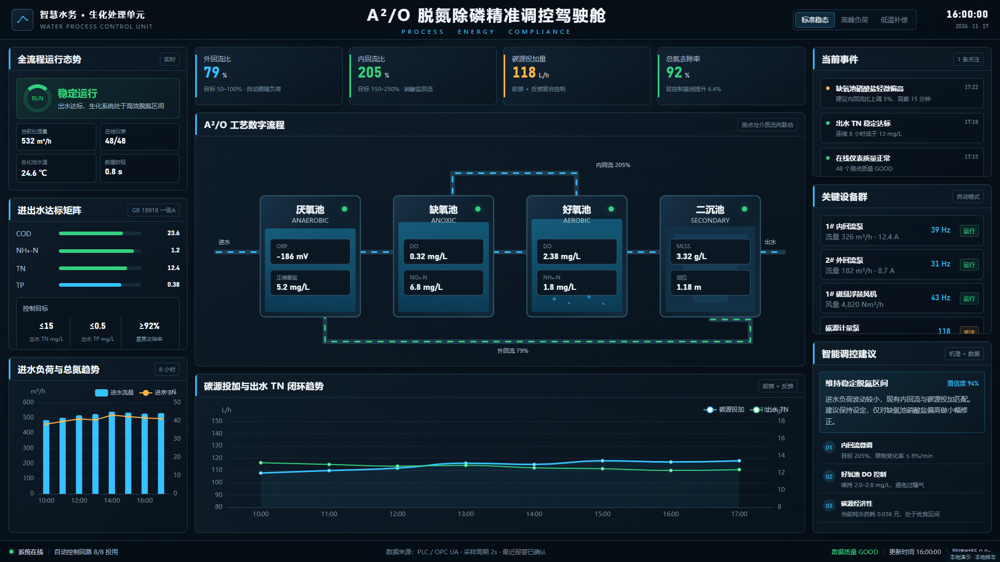
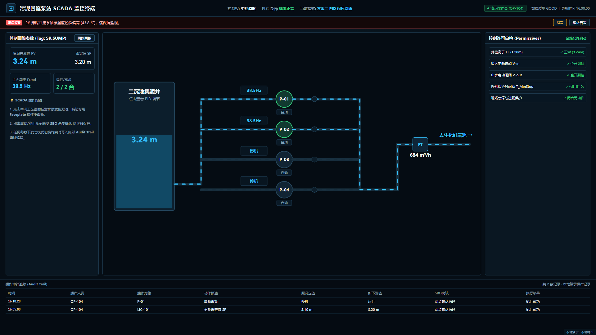

# 编辑器 V2：01/05 首轮验收

日期：2026-11-17。分支：`codex/visual-config-platform`。完成范围：两套二维 V2 模板、通用组件及编辑—绑定—发布闭环；六类/最多 12 套计划继续推进。

## 结果与原版对照

| 项目 | 本轮结果 |
| --- | --- |
| 01 生物处理 | 四池、内外回流、侧栏、KPI、达标面板、设备、事件、建议和两张双序列双轴历史图表恢复；三工况 KPI 12/12 |
| 05 回流泵站 | 四泵管网、液位回路、五个命名插槽、设备面板、演示两步确认与审计 |
| 固定样本视觉 | 01 SSIM 0.999197；05 SSIM 0.991130；阈值 0.97 |
| 共享实现 | 01 趋势放入 05，换绑泵频率后自动使用测点名称、Hz 与自适应轴范围；05 泵组放入使用 01 样式的空白页 |
| 空白组装 | 插入四池、指标卡与趋势；复制卡片、改名、换绑、成组移动、解组、发布重开 |
| 完整用户流程 | 选模板 → 改文字/布局 → 接只读 REST → 返回原对象换绑 → 发布 → 展示端重开 → 离线导出 |
| 异常与兼容 | 零/false、缺失、离线、恢复、故障优先；1366×768、1920×1080、3840×2160；旧 V1 工作流通过 |

视觉测试固定浏览器、时钟、演示数据和动画采样状态；原版 ECharts 在关闭动画后采集完整曲线。01 全图参与对照。05 仅遮罩通信/演示身份与审计标题元数据：顶部 `y<54, x>=470`，审计标题 `900<=y<940, x>=1100`。设备、业务图形和主要面板参与对照。SSIM 是该样本的画面指标，不能解释为全部编辑能力或现场还原百分比。

| 01 · V2 渲染结果 | 05 · V2 渲染结果 |
| --- | --- |
|  |  |

原始 HTML 未修改。V2 分别包含 285/166 个 DOM/SVG 对象与 39/27 个映射；对象数量包括结构与装饰，不能当作业务组件数。不是 iframe 或整页截图，设备、池体、文字、管道、图表序列均可独立选择并修改适用参数。

## 操作方式与直接优化

1. 运行 `node apps/scada-designer/server.mjs`。选择 01 或 05，明确选择“载入原版演示数据”或“保留当前连接与点表”。原连接不会被默认替换。
2. 点击画布对象或展开对象树。设备优先整体选中，Alt 点击选内部标签。右侧改位置、宽高、文字、颜色、序列和管道转折点；支持复制、锁定、对齐、成组、撤销与重做。
3. 进入“配置数据绑定”，按运行、故障、模式、频率等命名插槽选点。“管理连接与点位”完成或取消后返回原对象；错误不破坏原配置。KPI 单位跟随测点，数值趋势换绑时同步名称、单位并自动适配轴范围。
4. “预览发布”中测试工况及面板，再发布。草稿与展示端分离；发布重开、版本及离线导出共用同一文档和渲染器。

修复了对象树被根节点折叠后空白、设备标签误选、SVG 坐标/尺寸换算、实时刷新打断布局输入、组合移动后解组丢位置、复制引用、旧画布误被新组件替换，以及 PID 面板误读 PV 等问题。05 总流量改为独立测点，不在真实源下按运行泵数估算。来源与质量提示区分本地演示和真实只读数据。

## 验证命令与证据

| 命令 | 结果 |
| --- | --- |
| `node tests/studio_model_check.mjs` | 通过：旧模型、映射、时间/质量、零/false |
| `node tests/studio_v2_model_check.mjs` | 通过：V2 图、引用/循环、插槽、复制、全部五种组合件、V1 兼容 |
| `python -X utf8 tests/studio_check.py` | 通过：V1 画布/点位管理/版本、三维联动与离线工作流 |
| `python -X utf8 tests/studio_v2_check.py` | 通过：原版对照、三工况、编辑/数据/发布、复用、空白组装、面板、只读保护与离线 |
| `node skills/industrial-dashboard/scripts/validate-dashboard.js scenarios` | 31 页通过，含本地私有测试页；不是 31 套产品 |
| `python -X utf8 tests/interaction_check.py` | 26 项通过；含 24 个原场景、一个本地私有场景和入口，不宣称覆盖全部 30 套 |

自动验收输出：`works/editor-v2-implementation/acceptance/results.json`，原版/V2 PNG、复用与空白页截图、01/05 离线 HTML 位于同目录。交互对照报告：`works/editor-v2-implementation/acceptance.html`，图片已内嵌，可离线打开。正式主图归档在 `docs/screenshots/`，关键状态在 `docs/screenshots/states/studio-v2-*`。

本机演示实例为 `http://127.0.0.1:8120/`，当前草稿和发布版均为 01 演示。默认 8099 已加载升级程序；原十点 Modbus 项目的草稿、点表和版本文件在服务刷新前后逐字节哈希一致，备份与核对记录在 `works/editor-v2-implementation/`。演示实例独立保存，不覆盖该项目。

## 尚未覆盖的范围

- 实时异常回归使用本机只读 HTTP 测试接口。本轮没有重新完成现场 OPC UA/Modbus 设备验收，没有真实设备写入；历史现场结果不冒充本次结果。
- 05 模式、启停、频率、液位设定仅操作本地演示数据；真实连接禁用控制按钮，真实页面不生成演示审计。导出的真实快照保持只读。
- 尚无任意交互脚本配置、自动管道布线、通用八方向缩放柄或完整三维资产编辑。建议文字与阈值预设不代表在线工艺优化算法。
- 01/05 是 P1/P2 的二维首轮里程碑，其余四类及高级共用能力待 P3。Showcase 保留原 30 套作品入口，不新增重复场景卡片，不将两套 V2 写成 30 套已迁移。

下一阶段沿用同一对象/绑定/发布链，先做 17 的底图与热点，再推进 08 水处理三维、28 就地控制屏和 30 空间数字孪生。
