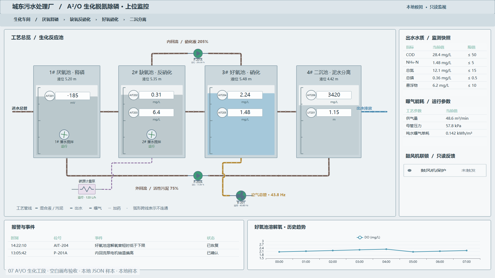
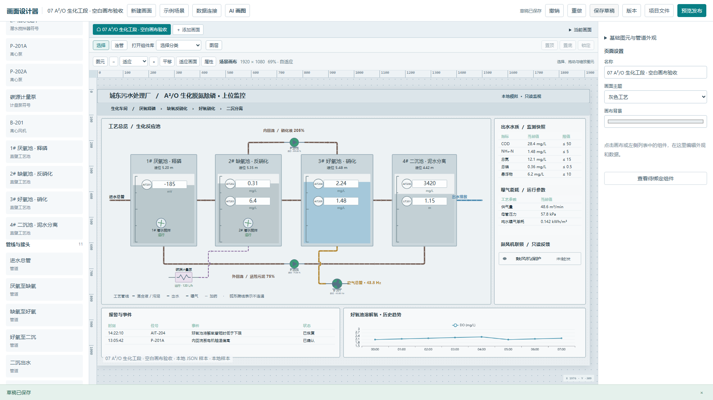
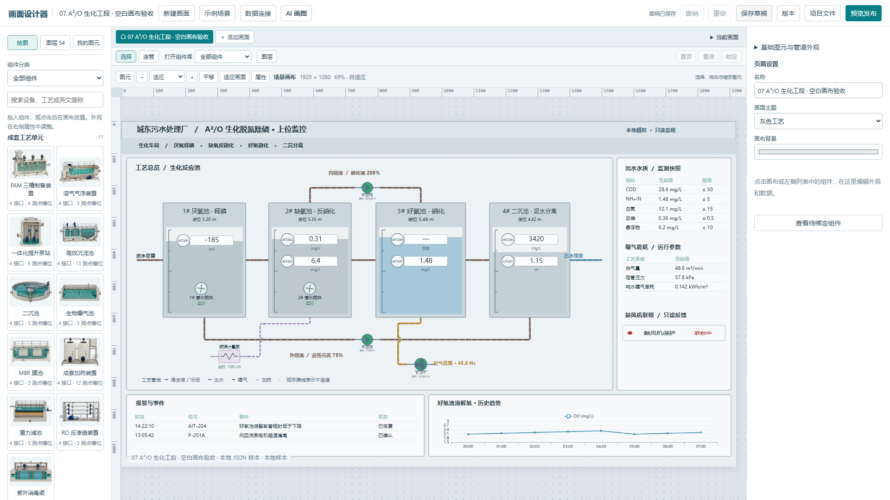

# 07 号 A²/O 经典上位监控重建验收

以 [07 号原版画面](../screenshots/07-a2o-classic-scada.png) 为对照，从空白 1920×1080 画布搭建厌氧、缺氧、好氧和二沉主流程。通过编辑器放置并连接独立图元，使用本地 JSON 样本的类型化槽位配置液位、模拟量、设备状态、历史和事件数据。最终发布工程包含 43 个图元、11 条管线和 41 处绑定。

## 本轮设计器能力

- 画布上方集中选择、连管、组件分类、图层入口、置顶、置底和锁定。图层列表按前景标注与数据、设备与工艺、管线与接头、背景与底板分组，并支持按名称、位号或类型搜索。
- 工艺管线自动按直角走线，可避让传统泵阀、池体和已有的设备图稿。手绘转折保持优先。按支路设置实线、虚线或跨线桥，配合箭头和运行反馈区分工艺介质与流向。跨线桥仅改变画法，连接关系仍由管口和实际接头决定。
- 工业控制分类新增直壁工艺池、位号仪表、潜水搅拌器、计量泵、联锁反馈五类可缩放图元。直壁池液位随测点和量程变化，位号仪表可绑定过程值、设定反馈和输出反馈，联锁反馈区分未触发、联锁中与质量无效。布局中池体低于仪表和搅拌器，避免恢复连管层级时遮挡测量值。

## 实测结果

- 使用生产界面创建并绑定四座池体、七块位号仪表、两台搅拌器、内外回流泵、计量泵、鼓风机和联锁反馈。右侧放置出水与能耗快照，底部同时显示历史趋势和报警事件。
- 上方工具栏切换 P&ID 分类，使用图层面板浏览四组对象，置顶后可撤销。移动好氧池后，两端连接保持，撤销后恢复原工程。
- 曝气线与污泥外回流交叉采用跨线桥，计量泵支路为虚线。发布与离线检查核对跨线弧的实际绘制和端点关系。
- 模拟联锁成立和坏质量输入，分别显示「联锁中」和「无效」。发布页可点开 AIT-204 的只读详情查看设定反馈和输出反馈。
- 发布页按 1920×1080、1366×768 核对，离线导出可直接打开，浏览器异常和离线 HTTP 请求均为零。本项目的设计器、工艺工具、路由、Agent 命令和场景交互回归均通过。

这次还原覆盖经典上位监控的读数、管网、反馈和历史。原版的模拟设定下发、报警确认与审计属于操作工作流，本例的设备详情和报警列表按只读信息展示。拥挤场景仍可通过转折点人工指定回流和加药走廊。

[编辑器](http://127.0.0.1:8142/) · [发布画面](http://127.0.0.1:8142/view)

复现命令为 `python -X utf8 tests/studio_scene07_classic_ui_check.py`。工程、运行结果、两种分辨率截图与离线 HTML 位于 `works/scene07-classic/`。

