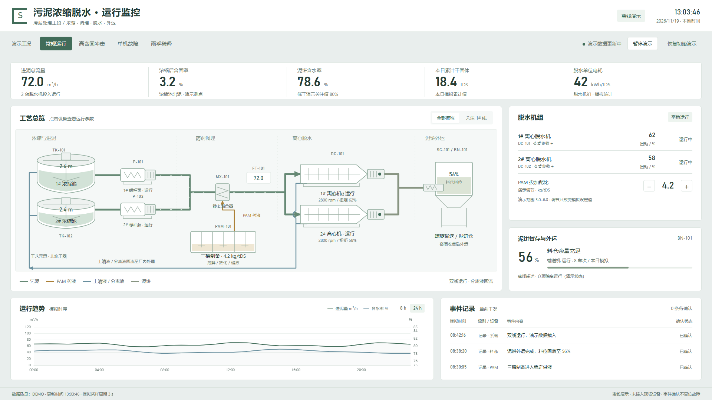
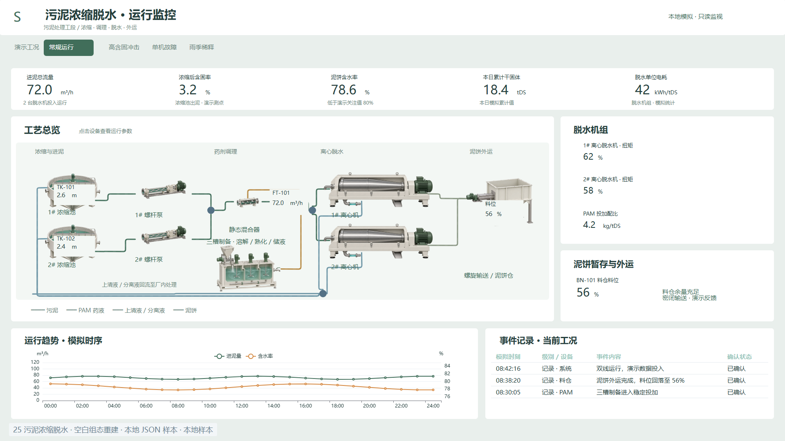
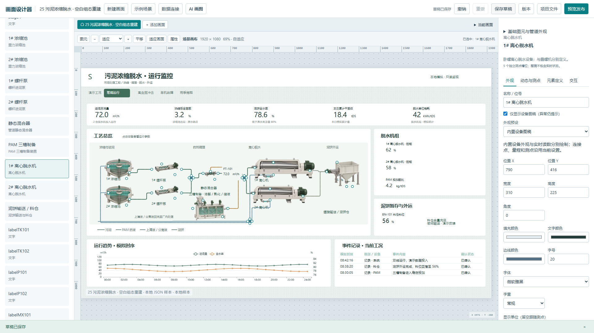

# 25 号污泥浓缩脱水：空白画布重建验收

## 本轮目标与方法

以原版 `scenarios/water-treatment/25-污泥浓缩脱水全流程智能监控中心.html` 为对照，在同一画面设计器的空白 1920×1080 画布上重建。没有导入原版 DOM、没有将整幅截图用作底图，也没有增加整场景模板或场景专用渲染分支。

验收脚本 `tests/studio_scene25_ui_check.py` 建立独立测试工程，初始 nodes/pipes 均为空。通过生产 UI 放置图元、设置尺寸和文字、从设备圆形管口实际拖线、逐槽绑定测点、保存、发布和导出离线文件。初始数据是 35 个本地模拟测点，包含布尔反馈、工程读数、趋势及事件数据集；不代表现场设备验收。

工段覆盖：两座重力浓缩池、两台螺杆进泥泵、静态混合器、PAM 三槽制备、两台卧螺离心脱水机、泥饼输送/料仓、上清液和分离液回流。

## 通用组件与产品修复

新增六类可复用图稿组件：重力浓缩池、螺杆进泥泵、卧螺离心脱水机、PAM 三槽制备装置、泥饼输送与料仓、静态混合器。设备定义包含端口、槽位、详情和独立图稿，进入同一组件搜索、Agent 目录、复制、撤销和离线打包机制。图稿组件累计 25 类。生成提示词与图稿散列保存在 `packages/components/studio/assets/water/provenance.json`。

实测推动的修复：

- 连管时临时抬高设备端口层，解决覆盖在设备上的数值仪表挡住管口、无法拖线的问题；选择和运行模式保留原始层级。
- 自动走线按等比图片区域避让设备，根据设备位置及尺寸重新计算。手动转折点优先，可点击“恢复自动走线”。自动生成的折点不写进工程，避免一次鼠标操作后将自动路径意外冻结。
- 设备增加简洁显示，适用于密集工艺图；已知故障、数据失效和未绑定提示继续显示。趋势和表格支持隐藏重复标题及有效质量脚注。
- 数值仪表的文字改为等比显示，新增单位独立字号，解决窄宽读数框中文字和工程单位拉伸、过大的问题。

自动走线仍是二维正交线：使用设备图片矩形包围盒和局部障碍，超过 35 个局部设备时退回既有路由；不会识别任意图片的所有内部几何和施工意义，也不承诺所有密集布局均无需人工调整。

## 验收结果

完整重跑结果：70 个图元、16 条管线、58 处绑定，所有自动管线的手动转折点均为空；31 个已连接端点在设备改宽改高后与管口圆心的最大屏幕误差约 0.0033 px。两步撤销精确恢复修改前工程。简洁显示下故障及坏质量检查通过。1920×1080、1366×768、离线零 HTTP 请求及页面零异常均通过。

原 19 类图稿组件的五页 UI 回归、25 类组件合同/发布校验、自动避让与设备出线方向、Agent 命令/意图回归、2.5D UI 回归、全场景静态校验与自动交互回归均通过。本轮没有把未执行的现场采集/控制操作列为已验证。

另外已复查 50%、100%、150%、200% 画布缩放、六类新增设备卡片与画布图片完整地址一致，以及发布态从名称文字框覆盖处点开设备详情。发布态无动作的装饰文字/底板允许点击穿透；显式跳转等交互保留。最终离线包也复查设备详情及零 HTTP 请求。

## 对照原版

已对应原版的顶部标题、五项 KPI、四段主流程、双线进泥/脱水、加药与回流支路、右侧机组/料仓、底部趋势和事件区。保留原版浅灰绿配色、主要版面比例和中文工艺语义。设备可点开通用详情查看各自绑定值及质量。

首轮验收时的差异（通用交互现已补充，见[后续验收](scene25-interactions-and-pipes.md)）：

- 原版采用二维工程示意符号，本次使用模块化 2.5D 图稿，设备轮廓和管口造型并非逐像素相同。
- 原版专用演示工况切换、单线聚焦、PAM 加减按钮和趋势时间档位尚未封装为通用交互；本次为常规运行的只读画面，不能把这些交互算作已还原。
- 演示数据、事件和累计值均为本地样本，不作为真实采集或控制运行的证明。

不使用未经定义和测量的“还原百分比”。该案例证明空白设计器可以搭出这类完整二维/2.5D 污泥处理工段；不据此宣称已经能复刻全部三十套场景的专有三维表现或交互。

## 可重复验收与证据

运行 `python -X utf8 tests/studio_scene25_ui_check.py`，默认从空白完整重跑；`SCENE25_RESUME=1` 仅用于调试中间草稿。结果、工程与原始截图位于 `works/scene25-rebuild/`，最终计数及缩放端点误差以 `results.json` 为准。

检查内容包含：真实拖入、实际管口拖线、设备宽高分别修改后连接保持、31 个绑定端点在缩放后的 SVG 位置与圆形管口中心比对、两步撤销恢复原工程、简洁显示下故障/坏质量可见、1920×1080 和 1366×768 发布、离线 HTML 无 HTTP 请求和页面异常。

本轮不修改原版编号场景，不增加场景套数。仅本地保存与发布，未推送远端。

本机独立验收入口：[编辑画面](http://127.0.0.1:8141/) / [已发布画面](http://127.0.0.1:8141/view)。工程数据位于 `works/scene25-rebuild/delivery/`，不覆盖 8140 上已有的未完成草稿；离线体验包位于 `works/scene25-rebuild/scene25-offline.html`。

后续迭代已完成工况切换、PAM 加减、趋势时间范围及管线视觉整理，最新交付与能力边界以 [通用运行交互与管线整理](scene25-interactions-and-pipes.md) 为准。首轮截图作为历史对照保留。
