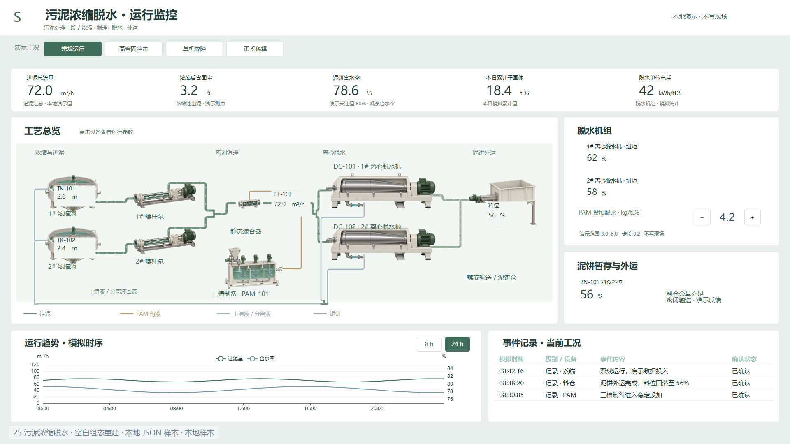
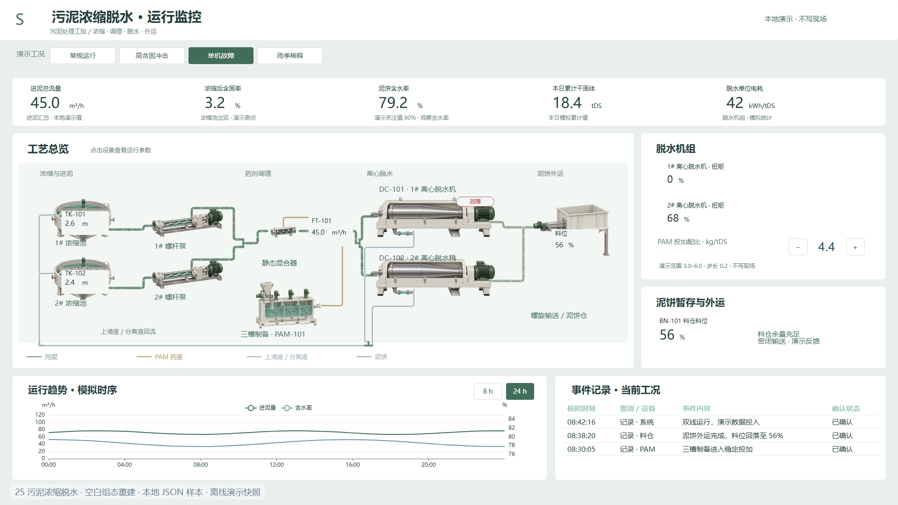
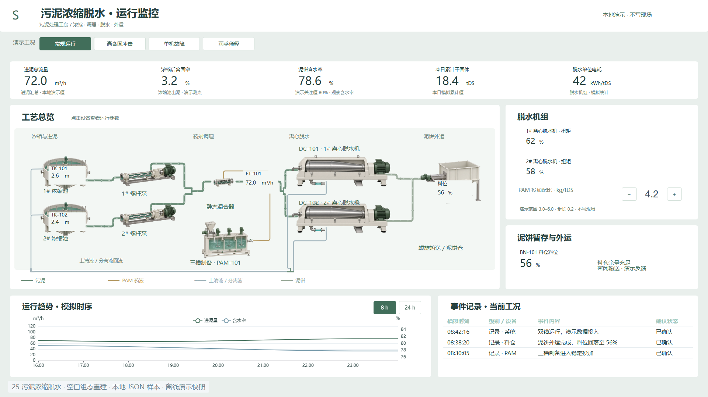
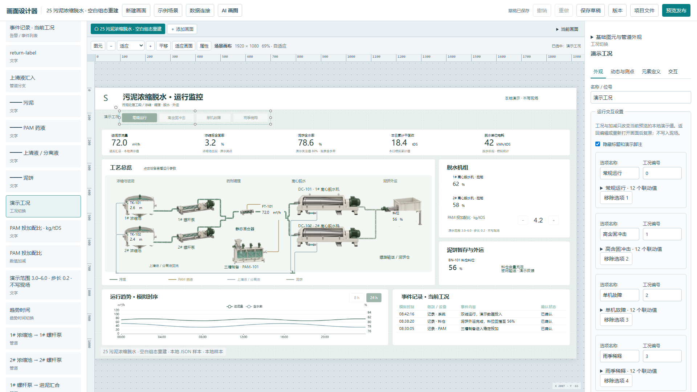

# 25 号工段：通用运行交互与管线整理

## 已实现

在首轮空白画布工程上继续通过生产编辑器配置，新增三类通用组件。组件使用同一图元目录、属性、槽位绑定、撤销、发布及离线机制，不按 25 号设备 ID 编写专用运行分支。

| 组件 | 配置方法 | 运行行为 |
|---|---|---|
| 工况切换 modeSwitch | 绑定“当前工况”数值点；添加布尔/数值联动点；填写各选项的联动值 | 当前选项高亮，整批更新当前演示读数；缺失或坏质量时拒绝整批应用 |
| 数值加减 numberStepper | 绑定“调节数值”，设置上下限、步长和小数位 | 加减、键盘 Enter；限制上下界；达到边界时禁用对应按钮 |
| 趋势时间切换 trendRange | 选择当前页趋势图，配置时间档位和默认档位 | 改变趋势显示窗口，不改变工程和源历史；可独立用于只读数据 |

配置面板按工况折叠联动参数，先选择测点，再逐个展开工况填值；不用一次浏览四份长表。

工况与加减只作用于明确标记为 demo 的本地 JSON/CSV 数据。刷新、重新打开或返回编辑后复原；不调用现场写入 API。现场连接仍可显示设备、质量和历史数据。返回编辑及源版本变化时清理当前演示值，坏质量不会被旧演示值覆盖。

趋势组件支持平滑曲线、隐藏数据标记和时分/时分秒刻度。历史数据的时间窗口以末尾时间为锚；短窗口切回长窗口仍使用完整源数据。数值实时采样仍有原有的 600 点上限，不凭空生成历史。复制趋势与时间切换组合时同步重映射目标 ID；独立图元导入另一画面时清空外部目标，提示重新选择。发布预检会定位未配置目标或无效交互参数。

配置面板中各工况的联动参数折叠显示，避免同时展开几十个输入框。按需展开一个工况设置即可；添加联动点时复用现有点名、类型及当前读数。

## 25 号配置

四个工况：常规运行、高含固冲击、单机故障、雨季稀释；联动 12 个测点，包含进泥流量、含固率、含水率、两台离心机运行/故障/扭矩、1 号离心机转速、静态混合器流量和 PAM 配比。故障工况下 1 号离心机停止流动动画并显示故障，转速归零；恢复常规时反馈恢复。历史趋势与事件表示既有历史，不被当前工况改写为伪历史。

PAM 使用通用加减组件配置为 3.0–6.0 kg/tDS、步长 0.2。趋势配置为 8 h / 24 h。本轮 75 个图元、16 条管线、72 处绑定，36 个本地样本点。缩放后 32 个管口端点与圆心的最大屏幕误差约 0.0033 px，两步撤销完整恢复；两条泵出口使用人工转折，其余 14 条保持自动路由。底层数据和图元均保留可编辑性。

## 管线视觉调整

- 新增“工艺管线”外观：5 px 主干、2.5 px 加药/回流支路，低饱和绿、土黄和灰蓝分别对应介质；白色细衬边区分交叉，不使用重黑轮廓。
- 管线接头按实际连接方向绘制短管，取消大型实心圆点。旧样式保留。
- 合并两座浓缩池的上清液与离心机分离液共用回流干线，消除并排重复的回流线；图例使用对应介质颜色。
- 螺杆泵图稿显示框与图片比例一致，进口贴合法兰、出泥接头从泵体上方接出。用原有转折点编辑器调整两条泵出口线，减少大范围绕行；其余管线继续自动计算，未宣称所有线路都无需工程调整。
- 设备名称、PAM 描述移开排液支路；简洁设备模式的故障标记移至设备上方，避免误落在下一台设备的名称上。
- 主流程仅用微小流动点与流向标记，回流和加药关闭流动动画，减少画面噪声。运行反馈失效或停机时停止相应流动动画。

这仍是二维画布中的 2.5D 图片工艺图，不是真三维模型和透视管网；设备外形与原版二维示意符号仍有区别。原版单线聚焦、暂停演示和实时时钟并未作为本轮完成项。

## 实测与复现

运行 `python -X utf8 tests/studio_scene25_refinement_ui_check.py`：读取首轮空白组态工程，经过生产 UI 打开数据连接、读取并应用本地样本，调整图元/管线，新增三类交互组件并绑定，逐个工况预览、PAM 鼠标加/键盘减、8/24 小时切换、返回编辑复原、发布、两种分辨率和离线 HTML 实测。设置过程不通过文档 API 注入设备布局或交互选项。

`SCENE25_REFINE_RESUME=1` 仅用于恢复调试草稿；最终配置过程已完整执行，调试后的运行链也再次回归。最终工程、结果、原始截图和离线包位于 `works/scene25-refinement/`。

独立单元回归覆盖上下界、只读源、坏质量、工况整批拒绝、时间窗口数据保留和跨画面图元复用。原 19 类组件 UI、25 类设备合同、Agent 命令/意图、画面设计器 16 项、2.5D 7 项及原编号场景的静态/交互检查均通过；具体结果随本轮报告保存。未进行真实采集或控制设备验收。

本机入口：[编辑器](http://127.0.0.1:8141/) / [已发布画面](http://127.0.0.1:8141/view)。上一版工程先备份，本轮不修改 8140 上其他未完成草稿，不修改原版编号场景，也未推送远端。

