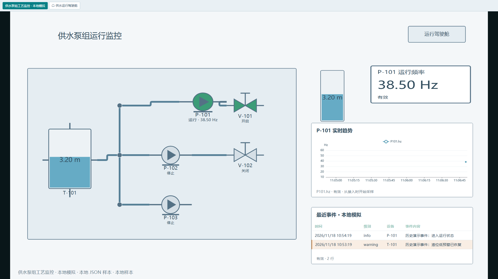
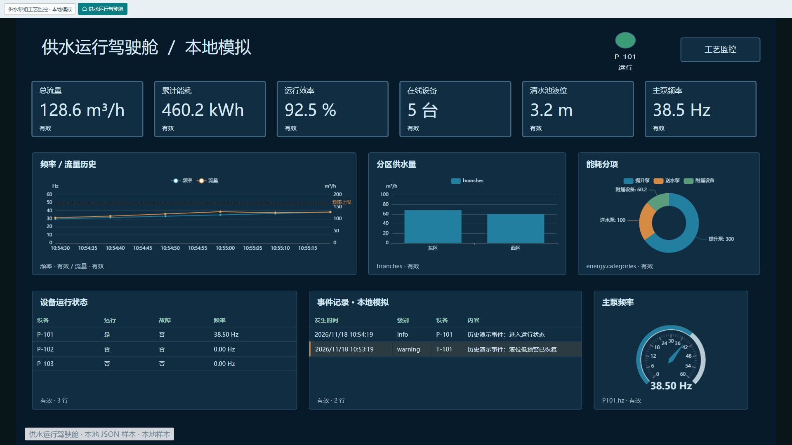

# 二维 SCADA / 驾驶舱设计器：M1—M4 整体验收

日期：2026-11-18。分支：`codex/visual-config-platform`。依据：[实施方案 v1.3](../plans/scada-screen-designer.md)。[41 项检查矩阵](screen-designer-stages.json) 保留需求与复现入口。

## 结论与边界

本轮完成方案限定的二维首版：从真正空白画布绘图、独立工业图元与管网、自定义连接点/数据槽位、有限显示规则、我的图元、多画面、通用驾驶舱组件、同区选点到发布和离线。原 01—30 不作为组件实现来源；新画面不存在场景 ID 特判。旧 V1/V2 继续兼容。

主验收两页均通过生产界面的鼠标、键盘和属性表单创建。没有通过脚本填充成品几何，也没有用原场景截图充当画布。合成规模测试单独建文档，不能替代作图验收。

当前一个项目共用一个采集连接，真实数据只读；告警/事件表展示上游数据。完整三维建模、实际控制写入、多源采集与生产长期运行验收属于后续范围。本轮没有设备操作、参数写入或远端推送。

## 从空白完成的两张画面

| 画面 | UI 创建结果 | 验证 |
| --- | --- | --- |
| A 供水泵组监控 | 16 个对象、8 条端口管道；一池三泵两阀、三个分支、标题/分区、数值、实时趋势、液位棒图、事件表、导航 | 逐台放置；移动/缩放/旋转跟随；手势撤销；成组/解组及内部管道复制；类型选点；0/false、故障、坏质量、过期、缺失、离线及恢复 |
| B 运行驾驶舱 | 15 个对象；六个指标、状态灯、双轴趋势、柱图、环图、设备表、事件表、仪表、标题和导航 | 字段/序列/轴范围/单位/图例/参考线可配；列名/格式/排序/行数可配；换绑跟随名称且保留显式范围；复用 A 的数值和趋势类型 |

两页保存重开、正式配置导出/导入、预览/发布、独立展示与离线一致。发布检查覆盖全部画面，问题可跳到正确页面/对象；编辑点击不执行运行动作。多画面版本回退改变展示版本，草稿保持独立。





## 组件和操作验收

| 范围 | 结果与脚本 |
| --- | --- |
| 基础绘图 | `studio_drawing_ui_check.py`：4 组，任意方向直线、折线、多边形顶点、字体/多行、静态 SVG 保存与离线 |
| 排版/变换 | `studio_layout_ui_check.py`：3 组，六向对齐、双向等距、8 个缩放柄逐一拖动及撤销、锁定/隐藏/层级、键盘与输入框隔离 |
| 元素定义和复用 | `studio_definitions_ui_check.py`：9 组，自定百分比端口、方向、稳定编号、引用删除保护、自定类型槽位/运行语义、规则、图元保存/导入/跨页重新绑定、缩放平移和面板折叠 |
| 工业图元/管道 | `studio_process_tools_check.py`：5 组，泵/风机/阀/池/仪表精细预设、开度量程、标签、液位方向、开放管端、属性与手柄重接、箭头和流向、发布离线 |
| 多画面和动作 | `studio_pages_ui_check.py`：6 组，子画面自定义端口/槽位/管端、添加/命名/首页、共享点表、全页发布检查、导航和只读趋势反复开关、离线、版本回退与草稿隔离 |
| Modbus 建点 | `studio_modbus_batch_ui_check.py`：3 组，1366 窗口建十个连续 float32、字序/地址步长、重复整批拒绝、保存一致；未连接设备也能保存合法点表 |
| A/B 完整流程 | `studio_cockpit_ui_check.py`：19 组（包含原空白工艺 14 组）；两页从零制作、通用组件、质量、三尺寸、发布、离线及配置导入导出 |
| 图表生命周期 | A/B 往返八次，仪表等共创建 49、销毁 45 个 ECharts 实例，剩余 4 个与当前 B 的可见图表一致；趋势面板另测三次开关 |
| 旧格式 | `studio_check.py`、`studio_v2_check.py` 通过；原 01/05 视觉比较只作为兼容证据 |
| 原场景 | `interaction_check.py` 通过；原场景源码未修改，画廊仍为 30 套 |

纯模型检查另外覆盖：端口引用/方向、事务式定义修改、深复制、类型/必需绑定、规则优先与质量、静态资源、跨页 ID/动作、双轴/字段/断点、表格零/false 和排序、主题保留自定义颜色、Modbus 边界/宽度/冲突。实时读数和图表采样不写入设计文档或撤销栈。

## 操作中修复的问题

- 开放管端在 X6 已显示、文档却未保存：在指针手势结束同步最终端点，重新保存/发布/离线验证。
- 当前画面菜单覆盖画布并可能误点删除：点击外部、切页或完成首页操作自动收起，关闭后再绘图。
- 子画面定义被重复计入校验：局部编辑只校验当前页几何，保存/发布仍检查全项目的对象编号与引用。
- 点表必须连上设备试读才可返回：合法配置可以离线保存，试读独立执行；运行质量由实际采集决定，不伪造有效值。
- 图表配置容易丢失输入：表单保留本地草稿，校验后提交；添加序列自动建立类型槽位，换绑保留显式范围。
- 深色画布标题/状态字不清晰、仪表值与刻度叠压：文字跟随主题，仪表数值移到刻度下方；三尺寸截图复核。

## 规模实测

`studio_load_check.py` 的独立合成负载为 **300 个可见节点、100 条管道、6 个图表、250 ms 共享采集**。

| 项目 | 当次结果 |
| --- | --- |
| 系统 | Windows 11 26100，Intel64 Family 6 Model 170 Stepping 4，18 个逻辑 CPU |
| 浏览器 | Chromium 148.0.7778.96，无头模式，1920×1080 |
| 首次进入到全部对象/图表就绪 | 2236.3 ms |
| 连续观察 | 6.10 s，22 次共享源采样；未随图表数量重复采集 |
| 浏览器主线程 TaskDuration 增量 | 2.966 s（CDP 指标，不等同 CPU 整机占用率） |
| ScriptDuration 增量 / JS heap | 0.043 s / 40.9 MiB |
| 请求动画帧回调往返 | 中位 22.1 ms，最大 146.2 ms，含测试通信开销，不换算宣称 FPS |
| 生命周期与错误 | 编辑/展示三次重建后仍为 6 个图表，无脚本错误 |

这是短时容量检查，没有做生产持续运行或现场物理 I/O 验收。1366×768、1920×1080、3840×2160 的展示等比和编辑面板折叠另由 A/B 与定义测试验证。

## 复现与本地体验

```powershell
node tests/studio_screen_model_check.mjs
node tests/studio_definitions_check.mjs
node tests/studio_pages_check.mjs
node tests/studio_widgets_check.mjs
node tests/studio_modbus_batch_check.mjs
python -X utf8 tests/studio_layout_ui_check.py
python -X utf8 tests/studio_definitions_ui_check.py
python -X utf8 tests/studio_process_tools_check.py
python -X utf8 tests/studio_pages_ui_check.py
python -X utf8 tests/studio_modbus_batch_ui_check.py
python -X utf8 tests/studio_cockpit_ui_check.py
python -X utf8 tests/studio_load_check.py
node tests/studio_model_check.mjs
node tests/studio_v2_model_check.mjs
python -X utf8 tests/studio_check.py
python -X utf8 tests/studio_v2_check.py
python -X utf8 tests/interaction_check.py
git diff --check
```

测试独立启用临时项目/只读模拟源；布局测试包含绘图测试，A/B 测试包含原工艺主流程。细项、文档、工况与离线文件保存在忽略目录 `works/scada-designer-stages/`。

启动服务后，在“项目文件 → 导入配置”选择 [供水 A/B 示例](../../apps/scada-designer/examples/water-process-and-cockpit.json)。该文件的几何来自本轮 UI 验收，只将临时接口改为本地模拟样本，无现场地址。新建仍是空画面，不隐含加载示例。操作细节见 [用户指南](../../apps/scada-designer/README.md)。

本机独立体验：[编辑器](http://127.0.0.1:8132/) / [展示端](http://127.0.0.1:8132/view)。8099 原项目重启前已备份，文件 SHA256 保持 `93e55761c27ae3d2f59bd1d955471e40ac3ed70c0ab0175a2635144e74bbbbaa`。8132 更新示例前也已备份；本轮未把历史现场读数视为新增组件的现场验收。
