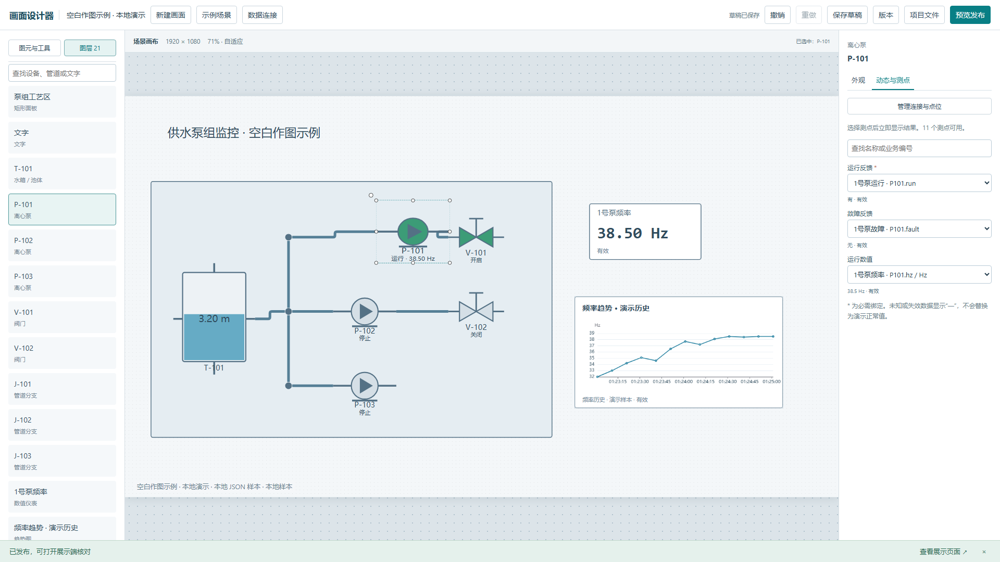
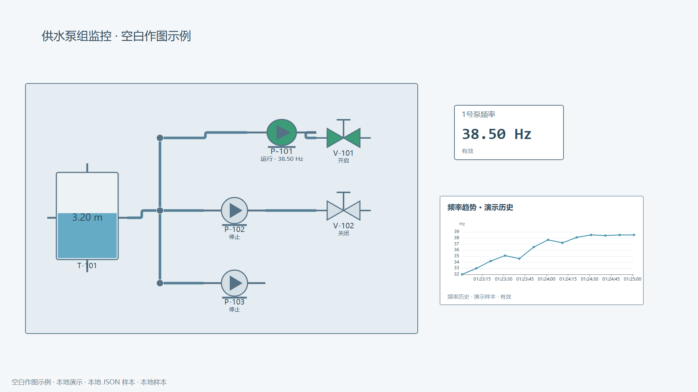

# 空白画面设计器：首个贯通版本验收

日期：2026-11-18。分支：`codex/visual-config-platform`。实施依据：[重订方案](../plans/scada-screen-designer.md)。

## 结论与范围

正式编辑器已能从零摆放独立泵、阀、池体并连接管道，设备变换后连接跟随；接入点表、绑定、草稿重开、预览、发布和离线导出使用同一模型。主验收没有加载 01/05 场景子树、皮肤或整页截图。原有项目不转换、不覆盖。

这次完成基础操作闭环，不代表整个设计器或 01—30 全部画面能力已完成。标尺/手动缩放、我的图元、通用规则/事件、多画面导航、完整驾驶舱组件与规模性能仍见方案缺口。现场接入是软件只读验收，没有输出写入或机械设备验收。

## 实际操作结果





1. 新项目零对象、零绑定；鼠标画出分区和标题。
2. 分别放入一池、三泵、两阀、三个管道分支、一个数值仪表和一个趋势。
3. 通过圆形端口拖出八条管道，端点保存设备 ID 与端口 ID。移动、缩放、旋转后验证实际 SVG 路径端点与接口中心吻合。
4. 在路径增加/拖动转折点；测试整次手势撤销。组从未选中状态直接拖动时两设备同时移动；复制重映射内部管道，并清空新设备槽位。
5. 在当前泵打开数据管理，接入只读 HTTP 测试源、读取十点并生成映射，返回同一泵。按类型选运行/故障/数值、开到位、液位和趋势。
6. 回归零、false、故障、坏质量、过期、缺失、整源离线与恢复。实时刷新期间保留尚未提交的尺寸输入。
7. 漏绑时阻止发布并直接定位；保存草稿重开与 JSON 一致，发布端文档一致，拖动无效，设备详情只读。
8. 1366×768、1920×1080、3840×2160 等比展示；导出本地单 HTML，验证图元、管道、依赖和快照。将离线浏览器时钟推进一小时，快照数值及其趋势时间窗仍按采样时刻显示。

测试脚本：[studio_screen_check.py](../../tests/studio_screen_check.py)。逐项结果、UI 创建的文档、截图及离线文件保存在 `works/screen-designer-implementation/acceptance/`。图中独立体验项目使用本地演示 JSON；历史曲线是明确标注的演示数据集，不是现场采集或补造历史。

## 操作中直接修正的问题

| 问题 | 当前行为 |
| --- | --- |
| 编辑、绑定反复切工作区 | 右侧“外观 / 动态与测点”在同一画布完成，管理点表返回原对象 |
| 实时刷新覆盖尚未提交的尺寸 | 几何输入保留本地输入草稿，提交时统一限制画布边界 |
| 缩放后管口出现空隙 | 图元绘制与端口同步伸缩，管道端点直接落在接口中心 |
| 首次拖动成组对象或另一个未选中对象时选择滞后 | 移动开始前同步选择，避免移动上一批对象或只拖走一个组员 |
| 复制后仍接原设备数据 | 新实例清空槽位；发布检查要求独立绑定，内部管道引用重映射 |
| 单次拖动产生多条撤销 | 一次指针手势只保存一次历史；运行读数不入历史 |
| 项目文件菜单横向溢出 | 竖向菜单，小屏仍可访问全部操作；成功导入后返回画布并关闭菜单 |
| 以后打开离线数值趋势时看不到快照点 | 以导出采样时刻固定数值趋势时间窗，不把历史点挤出显示范围 |

## 只读现场接入

现场地址和点表仅保存在本地 `works/`。独立项目从空白放一台泵和原码仪表，通过正式界面导入用户提供的 Modbus 十点表，绑定运行、故障和变频反馈原码，再保存、重开、发布。三次独立读数的接收时间推进，发布端泵状态为“停止”，与有效的运行 false、故障 false 一致。

记录时两个变频反馈原码约为 3984～3991，低于固定有效边界 4000；业务值为无效，仪表显示“—”。液位原码约 17811～17817，有效，但没有将原码猜成米或 Hz。记录包含 `raw`、`value`、`quality`、`receivedAt`；详情面板只有关闭按钮。

结果：`works/screen-designer-implementation/field/results.json`，8 项通过。另通过只读 GET 获取当前北向点表导出，十点的地址、设备/模块身份、别名、类型和 active 状态均与使用的点表一致，见同目录 `current-mapping-check.json`。现场波动读数只证明当次采样，不是持续正常承诺。本次没有重做 OPC UA 的十点业务验收，也没有执行任何启停、参数、设定值或输出写入。

8099 原项目在服务更新前已备份，更新及新画布试开/撤销后文件 SHA256 一致：`93e55761c27ae3d2f59bd1d955471e40ac3ed70c0ab0175a2635144e74bbbbaa`。8132 体验项目使用独立数据目录，未替换原项目。

## 回归与复现

```powershell
node tests/studio_screen_model_check.mjs
python -X utf8 tests/studio_screen_check.py
node tests/studio_model_check.mjs
node tests/studio_v2_model_check.mjs
python -X utf8 tests/studio_check.py
python -X utf8 tests/studio_v2_check.py
python -X utf8 tests/interaction_check.py
git diff --check
```

新模型测试验证格式、几何、端口引用、类型、质量和复制；新 UI 测试独立启动临时项目及只读 HTTP 测试源，不依赖现场网络。旧 V2 空白组合改为导入真实旧格式文档回归，不占用新空白入口；01/05 视觉结果只属于兼容验证。

原场景未修改，未因此新增 Showcase 卡片或增加场景总套数。原场景交互回归单独通过；没有将旧场景回归计入新画布通过项。全部修改留在本地分支，没有推送远端。

启动：仓库根目录 `node apps/scada-designer/server.mjs`，访问 `http://127.0.0.1:8099/`。设置 `STUDIO_PORT` 与 `STUDIO_DATA_DIR` 可启动独立项目。当前本机保留 `http://127.0.0.1:8132/` 本地演示；离线体验文件位于 `works/screen-designer-implementation/pump-process-demo.html`。
