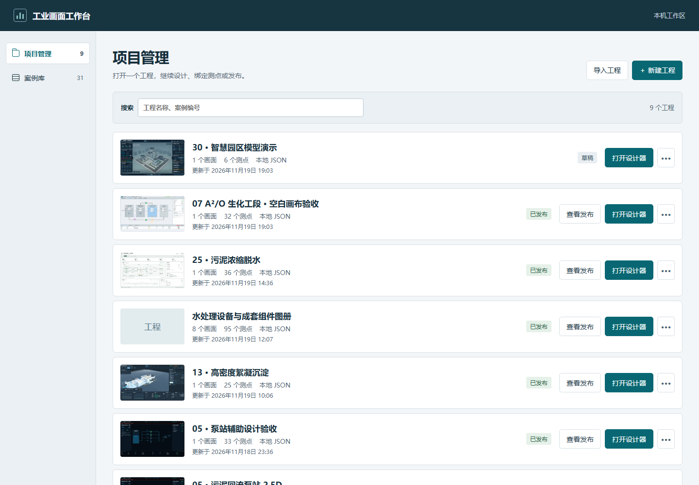
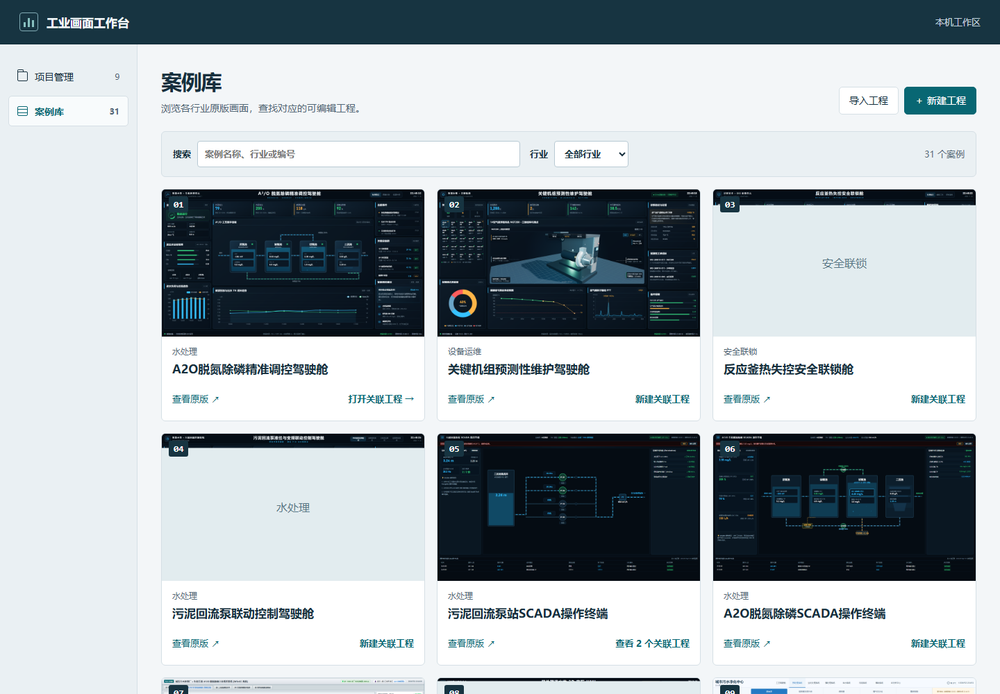

# 项目管理与案例库验收

本机使用 8142 作为统一入口。[项目管理](http://127.0.0.1:8142/projects) · [案例库](http://127.0.0.1:8142/projects?tab=cases)

- 案例库收录 01–30 号和 CSO 定制工艺，共 31 个可预览原版，支持行业、名称和编号筛选。缩略图使用原版截图。
- 项目管理归集 01、05 的两个工程、07、13、25、30 园区模型演示、水处理组件图册和供水泵组工程，共 9 项。工程与案例分别保存。没有编辑版的案例可以新建关联的空白工程。
- 可新建、导入、复制草稿和改项目管理名称。编辑器返回项目管理前会确认是否放弃未保存修改。每个工程独立保存草稿和发布版本。工程在列表上的名称与画面本身的标题可分别修改。
- 07 号原工程沿用现有数据存储，补充案例关联。迁移前备份位于原数据目录的 `project-before-case-library.json`。

浏览器回归覆盖 31 个原版入口、行业与名称筛选、打开原版、关联建工程、独立保存发布、复制、重命名、导入和窄屏布局。本机 8142 复核 31 个原版和缩略图均可读取，9 个工程的编辑入口及已有发布入口均可打开。原设计器与场景交互回归通过。

复现项目管理回归可运行 `python -X utf8 tests/studio_project_platform_check.py`。

