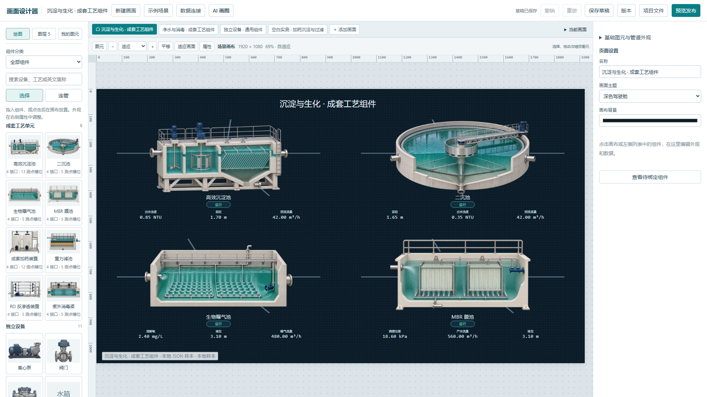
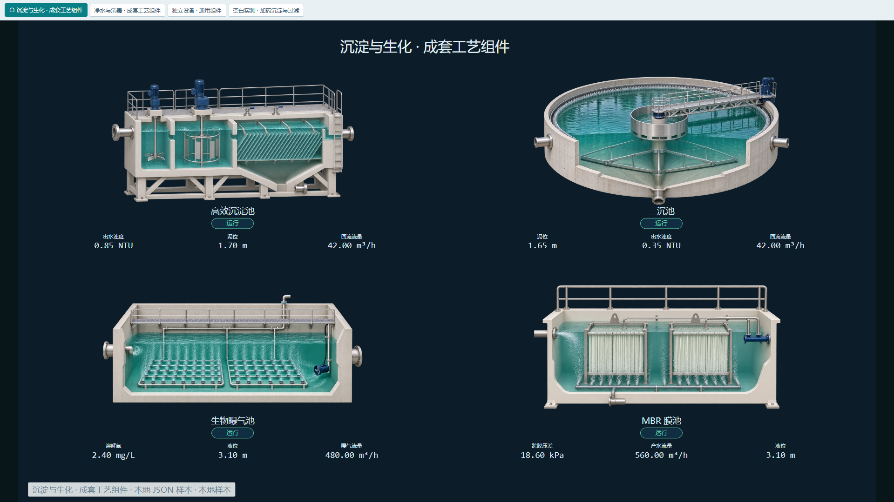
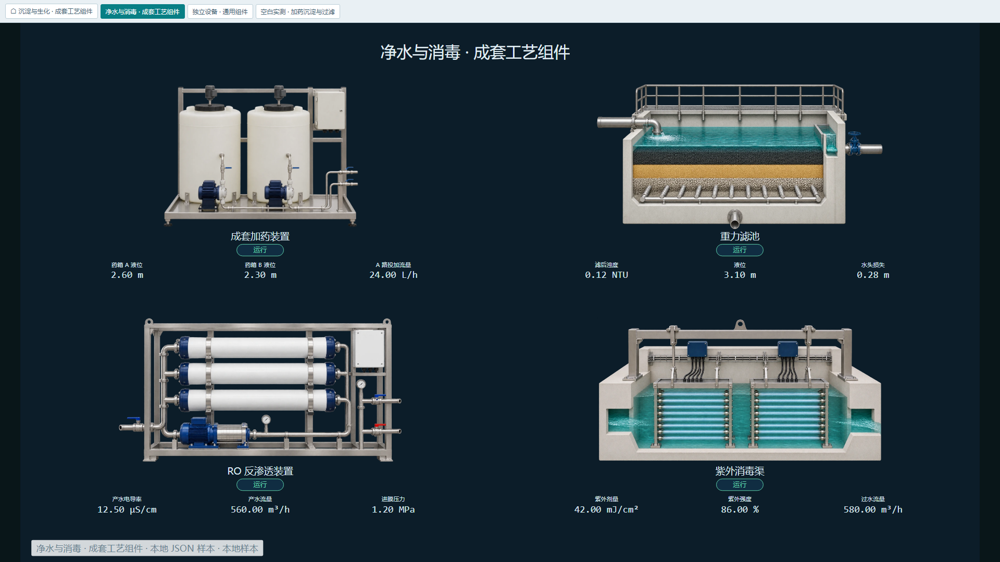
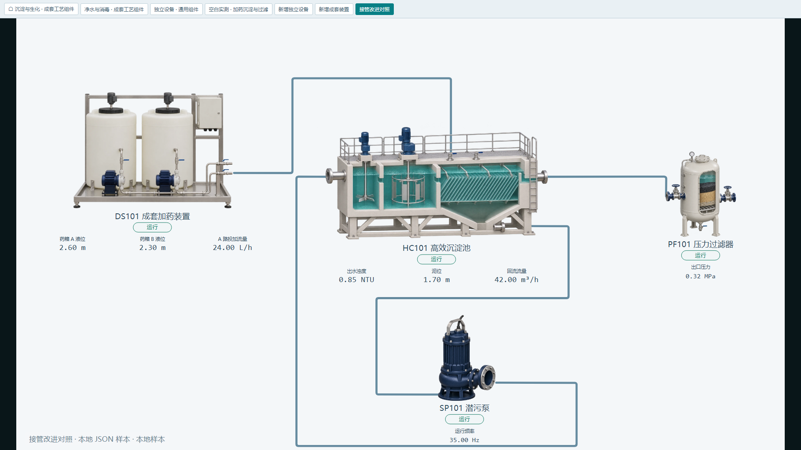
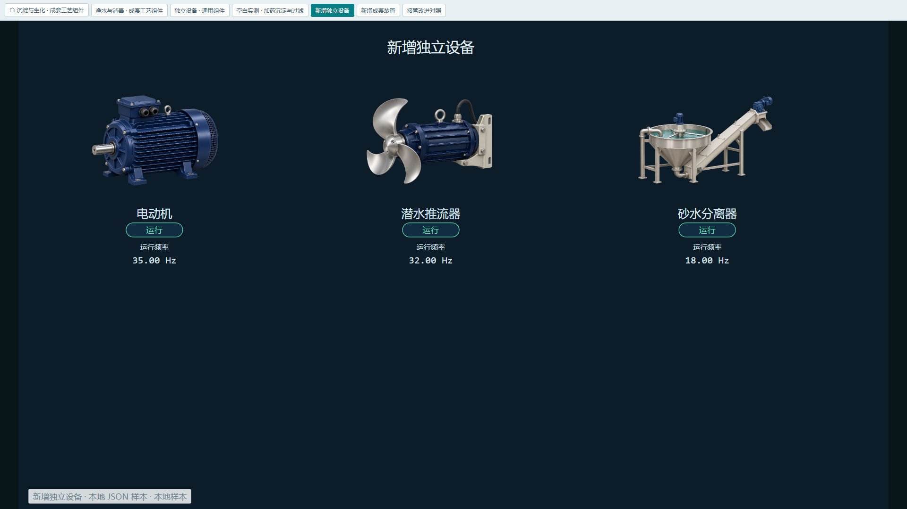
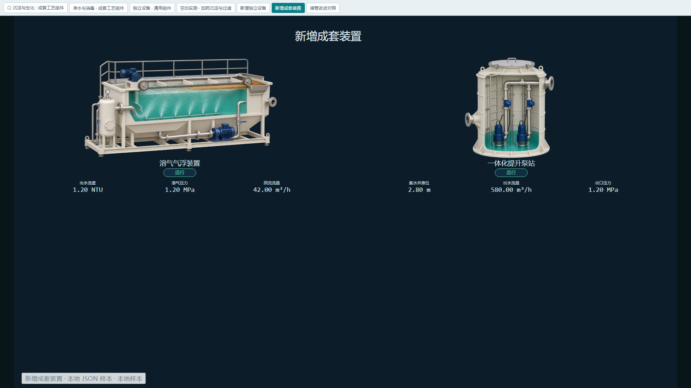

# 水处理设备组件库验收

2026-11-19，分支 `codex/visual-config-platform`。本轮将左侧资源区改为按组件用途浏览，并把常用水处理设备封装为可放置、接管、绑点、复制和离线交付的组件。

## 用户操作

1. 在左侧「组件分类」选择成套工艺、独立设备、数据素材、驾驶舱或基础图形，也可直接搜索中文名称或英文简称。无结果时可一键返回全部组件。
2. 看缩略图，拖入画布或点击后放置。成套组件自带设备图稿，与画面的经典/精细外观选择无关。原来的全局外观设置移到右侧折叠区，单个组件的外观仍在右侧属性里。
3. 选择「连管」，按接口的进出方向接管。必要时在管道属性里补转折点。图片、接口、测点和管道分别保存，缩放与换图不会清空已有配置。
4. 在「动态与测点」按槽位绑定。高效沉淀池的浊度、泥位、回流流量可同时使用 NTU、m、m³/h；附加槽位不会套用主数值的单位。
5. 检查读数和质量后发布。复制组件或从「我的图元」放入的新实例保留图稿和接口，测点从空绑定开始。

## 本轮入库

已有离心泵、阀门、止回阀、池体及风机仍可使用。本轮新增 14 种设备/工艺组件，各自具有固定的默认尺寸、接口名称与方向、数据槽位和只读详情。

| 分类 | 组件 | 默认测点槽位 |
| --- | --- | --- |
| 独立设备 | 潜污泵 | 运行、故障、频率 |
| 独立设备 | 立式搅拌机 | 运行、故障、频率；无工艺管接口 |
| 独立设备 | 立式药箱 | 液位、液位报警 |
| 独立设备 | 压力过滤器 | 压力、压差、流量、运行、故障 |
| 独立设备 | 机械格栅 | 运行、故障、频率；进出水与排渣接口 |
| 独立设备 | 叠螺脱水机 | 运行、故障、频率、进泥流量、含固率 |
| 成套工艺 | 高效沉淀池 | 浊度、泥位、回流、PAC/PAM 投加、两台搅拌机的独立反馈和频率、整机反馈，共 13 槽位 |
| 成套工艺 | 二沉池 | 泥位、浊度、回流及整机反馈 |
| 成套工艺 | 生物曝气池 | 溶解氧、液位、风量及整机反馈 |
| 成套工艺 | MBR 膜池 | 跨膜压差、产水、液位及整机反馈 |
| 成套工艺 | 成套加药装置 | A/B 药箱液位、两路流量、两泵频率和独立反馈、整机反馈，共 13 槽位 |
| 成套工艺 | 重力滤池 | 浊度、液位、水头损失及整机反馈；反洗进口与排水方向分别定义 |
| 成套工艺 | RO 反渗透装置 | 电导率、产水、压力及整机反馈 |
| 成套工艺 | 紫外消毒渠 | 剂量、强度、流量及整机反馈 |

成套单元不自动合并内部设备反馈。整机运行/故障必须使用已有整机点；A/B 路及两台搅拌机有独立槽位，在详情中查看。图稿里的水面、桨叶和灯管为静态结构示意，运行与测量结果由实时数据叠加。单机正面显示主数值，附加读数放在详情中；成套单元正面显示三项主要数值，避免小组件上多项长单位挤在一起。

## 图稿与封装

- 使用内置 `image_gen` 生成，未使用 API/CLI 回退。14 张初稿分别生成；MBR 返工透明背景，叠螺机、重力滤池、紫外渠和曝气池返工去除英文标牌。
- 最终透明 WebP、SHA-256、完整生成提示和修改提示保存于 `packages/components/studio/assets/water/`，见其中的 `provenance.json`。
- `water-equipment.mjs` 定义组件语义、接口、尺寸和槽位；`water-artwork.mjs` 嵌入图稿供运行时和单文件离线使用。新增组件不依赖任何编号场景的 DOM、设备 ID 或点表。
- `scripts/build-water-artwork.py` 只进行标准缩放、WebP 编码与模块打包，不进行补绘、抠图或文字移除；视觉修改均通过内置图像工具完成。构建后资源模块约 2.38 MB。
- 图稿使用统一的白色结构、蓝色机电、不锈钢与青绿色水体。不同设备的实际外形比例予以保留；横向拉伸节点时图稿保持比例，接口仍随节点移动。

## 实测与修复

`python -X utf8 tests/studio_water_components_ui_check.py` 使用生产编辑器及独立项目，从空白放入加药装置、高效沉淀池、压力过滤器和潜污泵，逐槽绑定本地模拟点，实际拖动接口连接四条管道，并通过管道属性编辑走线。覆盖：

- 左侧组件分类、搜索、无结果恢复及图稿缩略图。
- 多单位读数并存；修改宽度后绑定/端点不变，一次撤销恢复。
- 复制后清空绑定；故障、无效和真实时间戳过期分别显示，坏质量不继续显示旧数值。
- 保存重开、发布、1920×1080 与 1366×768 横屏等比显示、只读设备详情。
- 三张组件展示页覆盖全部 14 种图稿，实际解码 WebP；离线切换三页无 HTTP 请求、无脚本错误。

实测发现调整尺寸后 Tab 聚焦下一字段会增加空撤销步骤，已改为提交实际几何变更时才记录。单机三项数值挤在一起的问题已改为正面主值、详情完整读数。

`node tests/studio_water_components_check.mjs` 另验证全部组件的发布必填检查、额外槽位的角色/单位、质量与故障优先级、跨画面图元复用、绑定隔离以及 Agent 组件目录。原命令、图结构、模型传输、2.5D UI 与原场景交互回归保留。

Agent 已可读取新组件的类型、尺寸、接口含义和槽位，模型 Schema 允许使用对应 symbol。本机 `qwen2.5-coder:7b` 真实后端试验选中了 `lamellaClarifier` 并完成五个绑定，但初次画图没有同时绑点，拆分后又漏了主数值，需要补充一轮需求；不能将其表述为一轮自然语言自动完成。本轮真实模型试验仅在测试文档上产生提议，未改已保存的 13 号工程。预演、人工确认和发布必填检查继续保留。

## 证据

生产 UI、工程、三页组件图册、离线 HTML 与机器结果保存于 `works/water-components-acceptance/`。图像初稿、选定原图和素材 QA 保存在 `works/water-component-artwork/`。全部读数为明确的本地模拟点，本轮未连接现场设备。

这是组件库与设计器升级，不新增编号场景，不调整场景总数。工作保留在本地，未向远端推送。

## 后续修复：外观一致性、设备拆分与接管

根据实际拖入反馈，本轮新增电动机、潜水推流器、砂水分离器、溶气气浮装置和一体化提升泵站，图稿组件累计 19 类。电动机没有流体接口，原 fan 图元明确为“离心风机”，旧工程的 symbol 与绑定保持兼容。

旧泵、风机、阀门和止回阀的新建实例固定使用卡片对应的内置图稿；原有工程显式选择的平面外观保留。验收实际拖入离心泵，并逐项放置风机、阀门和止回阀，比较卡片与画布 image 的完整数据地址，而非仅检查外观名称。

新图稿组件的默认连接点改为设备图稿上的接口位置，按图片等比缩放同步计算，取消组件框到设备之间的长直线和斜线接管。用户自定义的端口位置仍按工程保存值处理。新接出的 2.5D 管线默认 5 像素管壁，圆角及管壁高光连续，减少粗线抢占设备主体。自动走线仍可通过转折点调整；本轮不宣称任意密集布局都能自动避开所有设备。

新增设备与装置也进入类型、槽位、发布和离线验收。五张图册覆盖全部 19 类；素材和提示词在同一 assets/water/provenance.json，嵌入模块约 3.25 MB。本轮继续使用本地模拟点，未连接现场设备。

## 污泥处理工段补充

图稿组件累计 25 类：新增重力浓缩池、螺杆进泥泵、卧螺离心脱水机、PAM 三槽制备、泥饼输送料仓与静态混合器。原 19 类继续通过五页组件库 UI 回归；新增六类在 25 号完整工段内验证拖入、接管、绑定与离线。图稿提示词及哈希继续归档于同一 provenance.json，嵌入图稿模块约 4.04 MB。完整对照和产品修复见 [25 号空白重建验收](scene25-blank-rebuild.md)。
