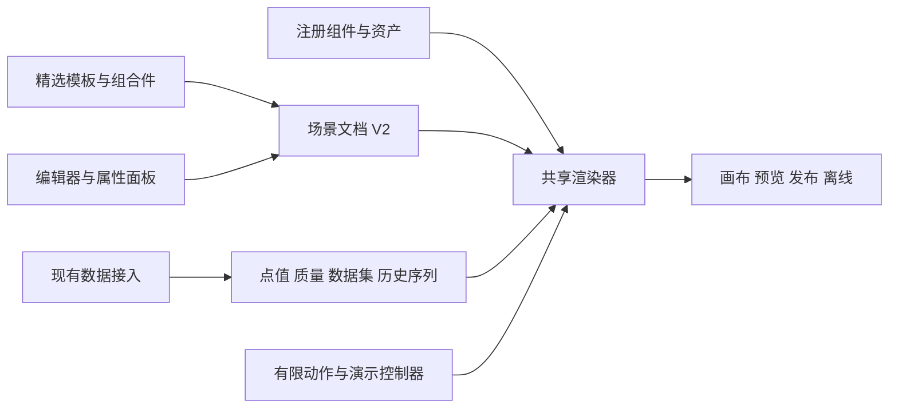

# 编辑器 V2 升级计划：六类能力与精选模板

版本：1.2，2026-11-17。工作分支：`codex/visual-config-platform`。状态：01/05 二维 V2 首轮已实现，其余四类尚待实施。[本轮验收记录](../acceptance/editor-v2-01-05.md)。

本版按用户最新要求收敛范围：01—30 号作为设计参考池，选择六类、每类 1～2 套代表模板，最多 12 套。原来的“30 套全部迁移”要求取消。升级重点是通用组件、资产复用和连续配置流程，模板数量不作为能力成绩。

## 1. 目标与完成定义

用户能够选择精选模板或新建空白页，使用同一套组件和资产完成布局、配置设备、接入数据、绑定测点、配置常用交互，再保存、预览、发布和离线交付。精选模板的画面和主要演示交互应基本保持原版水平，不能再退化成当前还原实测中的简单方框和普通数据表。

本轮同时交付：

1. **六类代表模板**：先完成每类一套，共六套；随后用第二套验证复用、补充差异，目标最多 12 套。每套均可编辑业务对象、外观、数据和交互，无须修改源代码或页面 JSON。
2. **可组合的组件与资产库**：模板中使用的卡片、图表、工艺图元、组合件、底图、三维容器和设备面板可单独插入、复制和换绑。每类至少有一次从空白页组合的操作证据。
3. **跨模板复用证据**：同一组件用于至少两个实际页面；至少完成一次跨类别组合，例如把 05 的设备面板、01 的趋势图放到 17 的底图页面，再接入新测点发布。

六类都应打通，但不承诺本轮精确还原未入选的另外 18 套。那些原页面继续保留为展示和参考；其中的独有设备、专用算法、镜头或效果，只有另行纳入任务并验证后才算支持。

不计为完成的情况：只嵌入原 HTML；整页截图覆盖几个读数；整个场景只有一个无法展开的节点；只能由开发者改代码才能普通配置；数值正确但丢失原工艺、历史趋势或设备面板。

三维建模、网格顶点编辑和任意 CAD/BIM 导入不在本轮范围。可使用已有模型；业务设备、测点、标签、镜头和状态必须可配置，静态建筑和装饰可保留为资产。

## 2. 当前基线与差距

已具备并继续使用：

- Vue 编辑工作区、1920×1080 画布、选择/拖拽/缩放、部分对齐与撤销。
- 选择场景 → 编辑画布 → 数据绑定 → 预览发布的基本路径。
- JSON、CSV、REST、WebSocket、OPC UA、Modbus TCP 只读接入。
- 草稿、最近五个发布版本、回退、项目导入导出与离线导出。
- 文本、图片、KPI、状态、基础流程、单序列图表、数据表、园区三维八类组件。
- 原场景、本地图像、SVG、模型及已有演示实现。

升级前 01 号仅有 13 个组件、18 个映射，四项 KPI 三种工况 12/12 一致，但缺少完整工艺和历史趋势。本轮已替换为 285 个 DOM/SVG 对象与 39 个映射，05 为 166 个对象与 27 个映射；恢复四池/回流、原双轴图表、设备和演示交互。对象数量包括装饰与结构，不能当作独立业务组件数量。

已盘点仓库跟踪的 01—30 号源文件。直接包含 WebGL 实现的有 10 个；02 还通过外部 NGT200 模块加载三维，不能因 HTML 中没有渲染器构造代码就排除。静态 script 引用可在工作区找到，纹理、HDR、模型子资源与实际运行仍需验证。

现有 `interaction_check.py` 直接提及其中 24 个场景文件，不能把此前“26 项通过”解读为全部 30 个通过。入选模板中 05、13、23 缺少直接文件引用，P0 优先补其关键交互定义；不为未入选页面扩充整套迁移验收。

源码扫描证据：`works/editor-v2-upgrade/source-inventory.json`。升级前实测：`works/scene-reproduction-01/`；当前验收：`works/editor-v2-implementation/acceptance/`。正式清单见 [精选模板与能力矩阵](editor-v2-template-matrix.csv)，[架构说明](../architecture.md) 已按 V1/V2 实现更新。

## 3. 模板选择：六类、每类最多两套

| 类别 | 首批代表 | 第二套 | 选择理由与应沉淀能力 |
| --- | --- | --- | --- |
| A 数据与工艺驾驶舱 | 01 A²/O 脱氮除磷 | 02 机组预测性维护 | 精细卡片、双轴多序列趋势、设备选择、诊断列表；02 验证三维设备块与数据看板组合 |
| B 二维工艺 SCADA | 05 污泥回流泵站 | 07 经典 A²/O 上位监控 | 泵阀管网、端口连接、设备面板；07 验证经典外观、棒图和 SBO 演示的复用 |
| C 底图与状态叠加 | 17 沉淀单元 | 15 连续分离工艺 | 原始底图、独立热点、标签、近景和数据叠加；验证浅色/深色配置，不复制两套底图编辑器 |
| D 水处理三维 | 08 预处理进水井 | 13 Densadeg 高密度沉淀 | 池体、设备选择、镜头、状态和动画；第二套验证不同构筑物/搅拌设备共用三维容器 |
| E 就地控制屏 | 28 鼓风机就地屏 | 23 循环水泵站就地屏 | 实体控件、键盘、就地/远程、频率、故障与复位演示；第二套验证泵站与不同屏幕样式 |
| F 楼宇与园区三维 | 30 多建筑园区 | 22 楼宇与微气候 | 对象树、复杂资产、镜头/图层、设备及空间标签；22 单独验证扫描资产、材质与室内视图 |

首批：**01、05、08、17、28、30**。第二批：**02、07、13、15、22、23**。12 个是上限，新增第二套应有明确的复用验证或新能力；如果只是颜色和排版差异，合并为现有模板的外观预设，不占新模板名额。

01—30 是参考池，不全部出现在“新建场景”中。原 Showcase 继续承载原作品展示，编辑器仅列出验收通过的精选模板。模板数与原作品数分别统计，README 不把 30 个作品误写成 30 个可编辑模板。

### 模板入口

- 默认展示六个推荐模板，每类一个，另提供“空白画布”。
- 类别筛选后最多展示该类两个模板，不把 12 个缩略图一次堆满。
- 显示实际预览、“适合做什么”和所需资产；主题/配色在选定后调整，不为每种颜色另建模板。
- 未完成模板不作为可用选项；导入或切换模板时沿用现有撤销和数据来源提示。

## 4. 通用实现的边界

采用“基础组件 + 工艺组合件 + 资产 + 模板”的四层关系，但仍由同一注册机制和场景文档驱动，不另建四套平台。

| 层次 | 内容 | 用户如何使用 | 实现约束 |
| --- | --- | --- | --- |
| 基础组件 | 文本、图片、KPI、状态、图表、列表、按钮、面板、SVG 设备/管道、底图及三维容器 | 插入、调整样式、绑定命名插槽、选择动作 | 相同能力只维护一份实现，不按模板编号复制组件 |
| 工艺组合件 | 四池及回流、泵阀支路、设备卡组、就地面板布局 | 整组插入，也能展开到设备、标签、图表和测点 | 保存为分组节点及默认参数；实例复制后 ID、管道和动作引用正确重建 |
| 资产 | 既有工艺底图、池体/机组模型、园区/室内模型、材质、镜头预设 | 从资产库选择，编辑业务对象和状态映射 | 模型差异用资产描述表达；不为每个模型再写一套选择和绑定面板 |
| 模板 | 组件/组合件实例、布局、主题、资产引用、演示数据和动作配置 | 一键起步，再按现场改配置 | 模板主要是数据；不各自带一套复制的编辑器、数据处理和发布逻辑 |

允许专用模型构建代码和少量原工艺演示控制器。它们须注册统一的对象、属性、绑定、镜头和销毁接口；不能把完整原页面藏进一个通用组件，声称已可编辑。尚无共性的特殊表现先作为资产或专用组合件，第二次出现再提取共性。

模板管理先使用本地清单和预览文件，暂不开发模板市场、收藏/推荐算法或复杂管理后台。组件版本先随产品发布，按实际兼容需要记录版本，不搭建独立包市场。

## 5. 必须补齐的编辑能力

| 能力 | 最小实现 | 验证对象 |
| --- | --- | --- |
| 外观 | 字体、行高、边距、颜色、边框、背景、圆角、透明度、数字格式和状态色 | 01 紧凑 KPI；07 经典 SCADA；23/28 控制屏各自保持原风格 |
| 画布与层次 | 嵌套节点树、框选/多选、成组、复制、层次、吸附、对齐/均分、锁定/隐藏、撤销/重做 | 工艺组合能展开；图形、树和属性选择同步 |
| SVG 工艺 | 池体、泵、阀、风机、仪表、正交管道、端口、分支/回路、箭头、水位、流动/旋转 | 01 四池及内外回流；05 泵阀管网 |
| 数据卡与列表 | 紧凑 KPI、设备卡、达标条、事件/操作列表、建议卡、棒图 | 01 两侧面板；02 设备及诊断信息；07 棒图 |
| 图表 | 多序列、多 Y 轴、时间轴、图例、阈值、历史序列；选定模板实际使用的折线/柱/饼等类型 | 01 双轴趋势；02 频谱与 RUL；不为未选页面提前实现全部图表类型 |
| 底图与热点 | 原始工艺资产、坐标锚点、独立设备热点、状态层、标签、全景/近景 | 17、15 同一容器换资产与参数 |
| 三维 | 模型/材质/HDR/灯光/阴影、业务对象树、射线选择、相机预设、图层/剖切、设备动画及标签 | 08/13 水工资产、02 机组块、22 室内、30 园区共用容器和绑定 |
| 面板和动作 | Faceplate、数值输入/键盘、模式、弹窗、工况切换、SBO、故障锁存/复位演示 | 05、07、23、28 原有主要交互 |

不实现通用 CAD 运算。专用池组、构筑物和设备群可作为组合件提供。三维建筑静态几何不要求拖拽改造，但其中的业务对象须能选择和换绑；可移动范围及锁定原因在属性中明确显示。

## 6. 用户的完整操作流程

继续保留四步工作区，不把配置交互再拆成一个独立向导。

1. **选择场景**：从六类推荐模板起步，或新建空白页。按需选择第二种示例，预览后使用。
2. **编辑画布**：左侧组件/组合件/资产与节点树，中间画布，右侧当前对象的外观、数据、交互。可展开组合到池体、泵、标签和序列；复制设备时一起复制相关标签和动作。
3. **数据绑定**：保留 KepServer 风格的设备目录、点表和属性。选定画布设备后显示“运行、故障、模式、频率、液位”等命名插槽，按类型筛选点位，选点完成返回原对象。支持选择一个设备组进行批量测点替换，先预览对应关系，再应用并可撤销，禁止按列表顺序猜配。
4. **预览发布**：集中检查必需绑定、素材、动作和质量。切换演示工况、无效、断线及恢复，确认后保存/发布。重开、回退、导出与画布一致。

对象的“交互”页提供有限动作：打开设备面板、切镜头/图层、切工况、修改演示参数。用户选择目标和参数，不写 JavaScript。点击趋势可选中序列并改单位/数据源/Y 轴；点击三维设备可定位节点树和绑定；切近景/地下视图后选择仍有效。

从模板切到真实数据时，模板的测点是可替换的业务槽位，不携带写死的 OPC UA NodeId 或 Modbus 地址。保留连接与载入演示数据需明确区分；不静默覆盖当前点表。

## 7. 最小可维护架构

继续使用 Vue、ECharts、Three.js、本地 Node 服务、文件存储及 Python 协议桥接。暂不增加数据库、微服务或独立工作流引擎，不以更换框架和依赖升级为前置任务。



以下是拟新增/调整位置，不表示已存在这些能力：

| 位置 | 职责 |
| --- | --- |
| `apps/scada-designer/studio/` | 现有入口；节点树、属性、绑定、交互和资产选择 |
| `apps/scada-designer/server.mjs` | 现有草稿/发布/采样；基于模板/资产清单的资源交付 |
| `packages/runtime/studio/` | V2 校验、V1 兼容、共享渲染、数据上下文、动作和生命周期 |
| `packages/components/studio/` | 注册的基础组件、工艺图元、面板和底图/三维容器 |
| `scenarios/<工艺分类>/<编号>/` | 入选模板配置、必要的资产适配/演示控制器及验收清单；原 HTML 不覆盖 |
| 现有 `assets/` 目录 | 模型、图像和材质；补业务对象 ID、参数、镜头及绑定描述 |
| `tests/studio-scenes/` | 入选模板的固定数据、对象与主要动作定义，以及跨模板复用用例 |
| `docs/screenshots/`、`works/editor-v2-upgrade/` | 通过后的正式截图与实施中的对比、日志和审计证据 |

编辑器只在共享渲染器上叠加选择框、辅助线和操控柄。原场景样式限定在场景根节点，处理 `html/body/#screen` 等全局选择器，避免与编辑器相互污染。ECharts/Three.js 组件统一挂载、更新、缩放、选择与销毁；资源按注册 ID 引用，不执行配置内的任意 HTML/脚本路径。

### 文档 V2

`schemaVersion: 2` 描述画布、主题、节点分组、资产、绑定与动作。节点包含稳定 ID、父节点、注册组件、位置/变换、样式、参数、命名绑定插槽及动作目标。具体字段在 P1 用 01/05 的真实需求冻结，不提前设计无限扩张的协议。

最小例子：一台泵有 `run`、`fault`、`frequency` 三个插槽，点击动作指向它自己的设备面板。普通用户在表单中配置，不接触内部 JSON。

校验 ID 唯一、父子无环、端口/动作/资产/测点引用有效、文档可序列化。撤销覆盖绑定与动作；复制组合时更新内部引用，保留外部共享资源。V1 项目及旧发布版本继续可读；加载时内存转换，首次保存 V2 前备份原配置。发布固定文档及资产版本，回退不误用更新后的模型。

## 8. 数据、历史与演示

- 保留一页一条共享采集连接；多上游系统仍由已有网关/接口聚合，不扩展成数据集成平台。
- 数据层统一点值、单位、质量、源时间与接收时间，组件只认业务测点。多插槽可绑定多个点；设备列表可由点集合组成，避免依赖上游手工预拼所有展示结构。
- 支持倍率、偏移、枚举、比较、AND/OR 和格式化等有限表单运算。复杂工艺使用注册演示控制器或上游计算结果，不新增任意脚本执行器。
- 数字量使用已归一化逻辑，不再次取反。模拟原码固定 4000～20000，按工程参数换算，不新增逐点人工确认门槛。
- 图表明确区分实时与历史。演示保留原确定性序列；真实历史来自 REST/已有数据集。OPC UA/Modbus 的即时读数不能冒充过去八小时历史；缺历史时显示实际可用范围或缺失状态，本轮不建时序库。
- 原启停、SBO、模式权限、故障锁存和人工复位在演示控制器中验证。真实数据沿用只读接入，不能把模拟按钮执行显示为设备现场执行成功。
- 演示状态与现场数据隔离；保留通信超时、输入有效性和已有基本保护。本轮不增加账号体系和高级安全门禁。

## 9. 阶段、依赖和预算

以熟悉仓库的一名开发者估算，目标 12 套为 **30—45 个有效开发日，按每周五个有效开发日约 6—9 周**，包含实现、自查和相关回归。这是工程估算，不是承诺日历日期；01/05 完成后按实际耗时修正，复杂三维资源问题单独记录。

| 阶段 | 估算 | 可审阅交付 | 完成条件 |
| --- | ---: | --- | --- |
| P0 精选基线 | 1—2 日 | 已盘点 30 个参考源；对入选 12 套补固定数据、资源、对象/动作及原版截图 | 清单与源码相符，原版问题和迁移问题分开记录 |
| P1 通用基础 | 4—6 日 | 文档 V2/V1 兼容、共享渲染、节点树、外观、命名插槽与复制撤销 | 嵌套设备可编辑、接数、保存发布，旧项目通过回归 |
| P2 先完成 01/05 | 6—8 日 | 两套高保真可编辑模板；图表、SVG 工艺、数据卡、面板和有限动作 | 原版对照达标，从空白组合通过；不再使用简化页充数 |
| P3 六类首批齐全 | 8—12 日 | 08、17、28、30；底图、三维、控制屏和复杂资产 | 六类均有一套通过；30 主要对象与视图可编辑，非现有四风机级别 |
| P4 第二套验证复用 | 8—12 日 | 02、07、13、15、22、23，目标累计 12 套；补确有需要的差异组件 | 共用能力未复制；第二套通过迁移及跨类组合，近似模板可合并 |
| P5 精简与交付 | 3—5 日 | 精选入口、六类空白组合、跨类复用、发布/离线、对照画廊和操作说明 | 最终模板清单逐套通过、V1 兼容通过、入口无未完成模板 |

依赖：P0 → P1 → P2 → P3 → P4 → P5。P3 后已有六类最小可用集；P4 用第二套检查通用性，不继续迁移未入选的 18 套。第二套如果与首套高度重复，合并而非追求凑满 12。

阶段审核默认由实施者自查，以具体截图、差异、操作记录和测试结果说明，不添加逐步等待用户确认的流程。新增能力优先修共用实现，不能给每套模板打独立补丁。

## 10. 首轮可直接执行的工作单

### P0：固定样本与可编辑范围

1. 核对 30 个参考源文件哈希；只对入选 12 套建立深入迁移基线，不全量迁移。
2. 逐套记录本地子资源、主要镜头、组件、业务对象、测点、动作、原有保护和预期可编辑参数。02 的外部机组模型、22/30 的独立资源链不能遗漏。
3. 固定时钟、随机种子、演示数据、镜头和动画采样帧，记录浏览器、GPU 与依赖版本。
4. 优先补 05、13、23 的原版关键交互定义，检查其他入选场景已有测试是否实际覆盖关键操作。
5. 形成“需求 → 公共组件/组合件/资产 → 模板 → 验收用例”的对应关系。第二套须说明验证哪些复用或补什么缺口。

### P1：完成一条真实对象编辑链

1. V2 校验、V1 兼容与迁移前备份；原发布版仍可打开和回退。
2. 文本、紧凑 KPI、分组、SVG 设备、命名插槽与多序列图表使用共享注册/渲染。
3. 对象 ID、画布元素、树与属性双向定位；布局、绑定、动作修改均可撤销。
4. 为同一台泵绑定三个独立点：运行、故障、频率；复制后新对象身份和动作目标正确。
5. 保存、预览、发布、重开与导出使用同一文档及组件，不另做一个简化展示端。

### P2：先补齐 01，再验证 05

01 的完成清单：

- 原标题、四个紧凑 KPI、侧栏、达标色带、设备卡、事件、建议与底栏保持原版效果。
- 四池、水位/曝气、进出水、内外回流支路和池内 ORP/DO 等标签完整。
- 两张图的双序列、双 Y 轴、历史时间轴及单位恢复；原三种工况按钮在页面内可用。
- 池体、标签、管道、KPI、图表序列、设备卡可选择并修改适用参数。
- 从空白页插入这些组件/组合件完成一次组装，复制一个泵或卡片，改名、换绑、发布、重开。
- 单点坏质量、整源断线、恢复显示正确状态，不回退成演示正常值。

05 接着验证管网连接、设备面板、模式和模拟控制，并实际复用 01 的卡片/图表。两套通过后再扩展三维和其他模板，不在 01 仍有明显缺项时继续加缩略图。

## 11. 验收标准

### 视觉和主要交互

- 所有入选模板以 1920×1080 基准对照原版，固定数据、镜头和采样时刻。
- 关键面板、业务对象和文本锚点的位置/尺寸偏差原则上不超过 2px，字号偏差不超过 1px；无缺图、缺设备、裁字、遮挡和意外换行。
- 二维稳定区域 SSIM ≥0.97 作为初始自动差异告警线，P2 用 01/05 校准；实测结果及 05 的元数据遮罩范围见验收记录。SSIM 仅代表固定样本画面，须结合工况、组件、数据和交互检查。
- 三维对照原资产哈希、镜头、材质、灯光、阴影及对象行为，不仅看全屏相似度。30 保留入选验收清单中的园区、机电、地下及主要视图；22 的室内与扫描材质另测。
- 主要原演示交互逐项验证，差异写清楚。真实控制、预测和诊断算法仍按已有能力边界说明，不借视觉还原夸大实现。

### 编辑、通用性和流程

- 最终精选清单逐套完成：选模板 → 改布局/对象 → 接数据 → 换绑 → 预览 → 保存发布 → 重开。
- 六类各完成一次空白页组合；可插入工艺组合件和既有三维资产，但须展开、修改设备与测点，不允许整页黑盒。
- 完成跨类组合：把其他模板的图表/面板放到不同主视图中，接入新测点发布，无模板 ID 特判、无源代码或 JSON 修改。
- 第二套实际共用首套组件；新增能力进入公共注册或资产描述。测试至少覆盖同一组件在两个不同模板中的行为。
- 复制、成组、撤销、绑定与动作引用正确；关键操作在常用横屏可完成，不被属性栏和弹窗遮挡。
- 模板入口首屏最多六个推荐，不暴露旧 30 个作品清单；配色变体不增加模板数量。

### 数据、兼容和交付

- 零值和 false 有效；缺失、坏质量、过期、离线不能变成正常零。覆盖适用的稳态、偏差、故障、断线、恢复；已有锁存场景仍须人工复位。
- 展示端验证 1366×768、1920×1080、3840×2160；原就地屏已有适配继续保留。
- 同机同配置下三维帧耗和加载初始目标不劣化超过 20%，P0 记录绝对值；不靠降低模型质量达标。重复挂载/卸载 10 次，不出现持续增长的定时器、订阅或 WebGL/GPU 资源泄漏。
- 草稿、发布、回退和离线均锁定对应文档/资产，无脚本错误及丢失资源；旧项目仍可读取发布。
- 小页面可单 HTML 离线交付；大型三维使用含完整本地资源与启动器的离线包，断外网可用。真实源不可用时如实显示，不冒充在线。

最终标准是：**六类均可用 + 精选清单逐套通过（6～12 套）+ 六类空白组合 + 跨类复用 + 旧项目兼容**。未入选 18 套不列为本轮失败项，也不标记为支持。

## 12. 验证与产物

实施时按修改范围运行现有检查；改场景和交互须执行项目规定的对应命令：

```powershell
node tests/studio_model_check.mjs
python -X utf8 tests/studio_check.py
node skills/industrial-dashboard/scripts/validate-dashboard.js scenarios
python -X utf8 tests/interaction_check.py
```

已新增 `tests/studio_v2_model_check.mjs` 和 `tests/studio_v2_check.py`，覆盖 V1/V2、节点引用/复制与 01/05 视觉、编辑、数据、动作、发布/离线。后续扩展到其余入选模板，不把 30 个参考源当成已迁移模板。每项独立报告通过/失败/跳过及原因，不能把未跑计入通过。

每套通过后交付模板配置、组件/资产清单、演示数据、绑定示例、默认与关键状态截图、原版对照/差异、关键操作记录及离线示例。按项目要求归档到 `docs/screenshots/` 和 `states/`，同步模板入口、Showcase 及中英文说明；不篡改原作品数量，不重复创建原场景卡片。正式截图标明原版还是 V2 模板，避免混用。

当前实现与验收范围是 01/05 两套二维模板。六类空白组合、其余四类迁移、三维资源/性能和十次 WebGL 生命周期验收仍待后续阶段，不纳入本次通过项。

## 13. 风险与控制

| 风险 | 最小处理 |
| --- | --- |
| 模板越来越多 | 六类、最多两套；新增必须补能力；颜色/排版差异合并预设 |
| 模板少但内部仍各写一套 | 公共注册/渲染/绑定；P4 用第二套查复制实现，跨类组合实测 |
| 通用化使画面降级 | 以原版为视觉基线，允许专用资产/组合件，不能用通用方框替代工艺 |
| 整页包装冒充编辑能力 | 设备级选择、命名插槽、复制和六类空白组合必测 |
| 过早抽象拖慢交付 | 先用 01/05 冻结最小模型，第二个真实用例再提取共性 |
| 复杂三维丢材质或泄漏 | 原资产与版本锁定，22/30 分别验收，统一生命周期 |
| 演示与现场混淆 | 独立演示状态，真实接入保持只读，质量和来源明确 |
| 旧项目及回退失效 | 双版本读取、迁移备份与文档/资产一同锁定 |

## 14. 不扩大的范围与下一交付

不建设多租户、协同编辑、插件市场、数据库、微服务、任意脚本语言、CAD/BIM 建模或真实设备写入。保留现有基本保护，不增加高级安全门禁，不推送远端。

已完成参考源盘点、六类/12 个候选选择，以及服务 01/05 的最小 V2 校验、共享渲染、命名插槽、对象编辑、跨模板组件、空白组合和发布链。01/05 是 P1/P2 首轮里程碑；P1 的交互属性配置、缩放操控柄及其他阶段通用能力仍需补齐。

下一阶段进入 P3，按 17 底图/热点、08 水处理三维、28 就地控制屏、30 空间数字孪生逐类推进，每类都沿用对象、绑定和发布链。需要的新能力进入公共实现；不批量增加模板缩略图。完整三维编辑能力不能以现有四风机组件代替。
